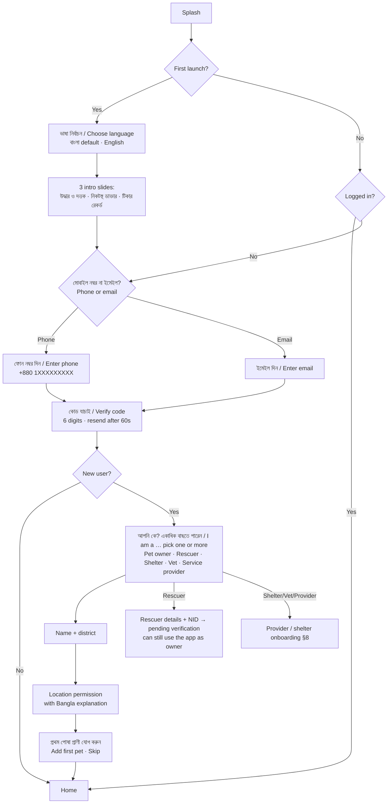
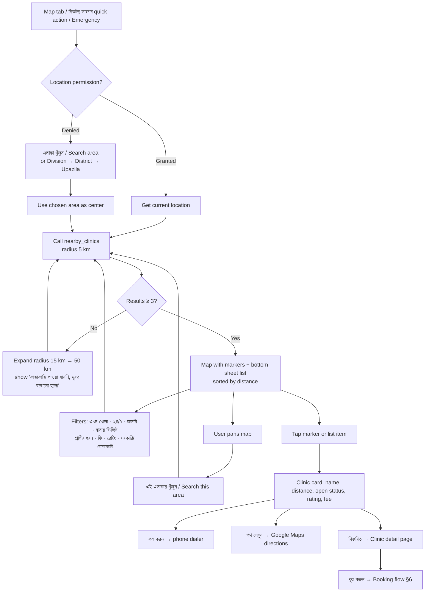
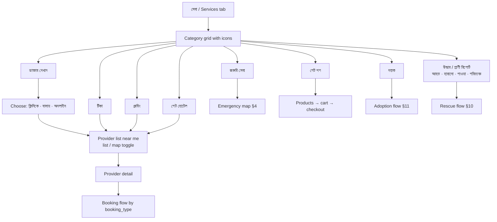
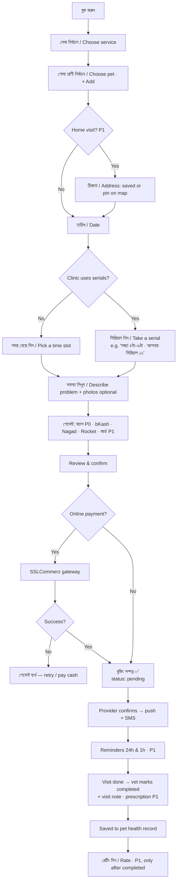
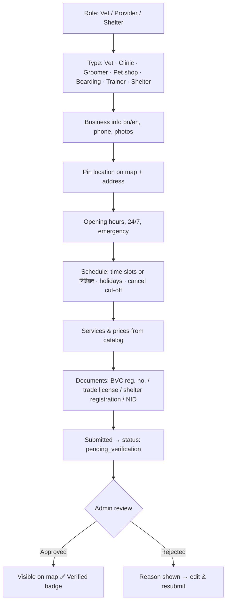
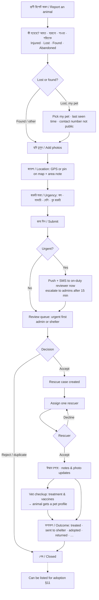
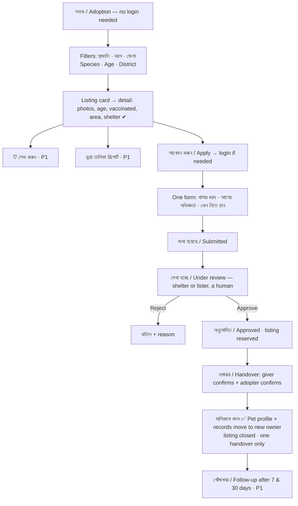
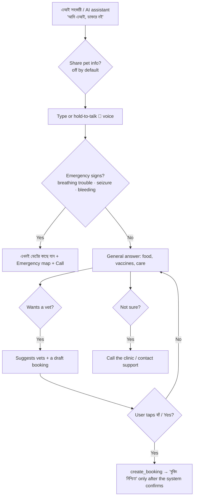

# Pranora — App Flow

Related: [prd.md](./prd.md) · [design.md](./design.md)

All screens exist on mobile app and website unless marked **(app)** or **(web)**. Labels are shown as `বাংলা / English`.

---

## 1. Navigation Map

### Pet owner — bottom tab bar (app) / top nav (web)

| Tab | বাংলা | Contents |
|---|---|---|
| Home | হোম | Greeting, my pets, quick actions (incl. প্রাণী রিপোর্ট করুন and দত্তক), upcoming reminders (P1), emergency button |
| Map | ম্যাপ | Nearest vets on map + list (other services as layers from P1) |
| Services | সেবা | Services catalog — MVP shows only P0 services: ডাক্তার দেখান · টিকা · জরুরি সেবা · উদ্ধার (হারানো/পাওয়া সহ) · দত্তক |
| Bookings | বুকিং | Upcoming / past appointments & orders, my adoption applications, my animal reports |
| Profile | প্রোফাইল | My pets, health records, my roles, settings, language |

A red **জরুরি / Emergency** floating button is visible on Home and Map. From P1 an **এআই সহকারী / AI assistant** entry sits in the Home header.

The adoption listings page (`/adoption` on web, Services → দত্তক in the app) can be browsed **without logging in**; login is asked only when applying.

### Role switcher
A user with several roles (e.g. pet owner + rescuer) sees a role switcher at the top of Profile. Rescuer and shelter modes add their own tabs; pet-owner tabs stay the same.

### Rescuer (উদ্ধারকারী)
Assigned cases (accept / decline) · Case page · My area & availability (P1)

### Shelter (শেল্টার) — web + app
Rescue report queue · Cases · Adoption listings · Applications · Handovers · Shelter profile

### Provider (vet / clinic / shop)
Dashboard · Bookings · Schedule (slots or serials, holidays) · Services & Prices · Clinic Profile · Earnings · Reviews

### Admin (web only)
Overview · Verification (vets, shelters, rescuers, adoption listers) · Urgent rescue queue · Clinics · Users · Bookings · Adoption listings · Content · Reports (fake listings/reports) · Audit log (P1) · Settings

---

## 2. Onboarding & Auth



Browsing adoption listings, the map and services works without login; login is asked when the user applies, books or reports.

---

## 3. Home

1. Greeting: "শুভ সকাল, রাফি 👋"
2. My pets carousel → tap to open pet profile; "+" to add
3. Next vaccine due (from the vaccine record) → **বুক করুন**; from P1 this becomes the reminders card (e.g. "মিনুর র‍্যাবিস টিকা — ৩ দিন বাকি") with **Mark done**
4. Quick actions (MVP): নিকটস্থ ডাক্তার · অ্যাপয়েন্টমেন্ট · প্রাণী রিপোর্ট করুন · হারানো প্রাণী · দত্তক · জরুরি; পেট শপ and গ্রুমিং are added in P1
5. Next booking card; status of my latest animal report / adoption application
6. Rescuer mode only: "নতুন কেস" card with accept / decline
7. Tips / articles (Bangla) — P1
8. Emergency button

---

## 4. ⭐ Nearest Veterinary on Map



### Clinic detail page
Photos · Name (bn/en) · Verified badge · Distance & address · Open now / hours for the week · Doctors (with BVC reg. no.) · Services with prices · Species treated · Reviews · Buttons: **কল করুন**, **পথ দেখুন**, **বুক করুন**, **শেয়ার**, **ভুল তথ্য রিপোর্ট করুন**.

### Emergency mode
Red header "জরুরি সেবা" → only open-now / 24-7 clinics → nearest first → big **কল করুন** on each item → hotline numbers at bottom → optional "জরুরি অনুরোধ পাঠান" (sends request to nearby clinics that support it).

### Layers (P1)
Toggle chips on top of map: ডাক্তার · গ্রুমিং · পেট শপ · পেট হোটেল · শেল্টার.

### Website differences
Split view: list on the left, map on the right (desktop). On mobile web it behaves like the app (map + draggable bottom sheet). URL keeps state for sharing/SEO: `/map?lat=23.74&lng=90.37&open=1&service=home_visit`, plus static SEO pages like `/vets/dhaka/dhanmondi`.

---

## 5. ⭐ Services Catalog



MVP grid shows only P0 services (ডাক্তার দেখান · টিকা · জরুরি সেবা · উদ্ধার · দত্তক). Grooming, pet shop, boarding and the rest appear when their phase ships.

Each service page shows: what it is, price range, how it works (3 steps), providers near me, FAQs — all bilingual.

---

## 6. Booking Flow (appointment / home visit / vaccination / grooming)



Booking statuses: `pending → confirmed → in_progress → completed`; side exits `cancelled_by_owner`, `cancelled_by_provider`, `no_show`, `expired`.

Cancel / reschedule buttons are shown until the clinic's cut-off (e.g. "অ্যাপয়েন্টমেন্টের ২ ঘণ্টা আগে পর্যন্ত বাতিল করা যাবে"); after that the screen shows the clinic's call button instead. Reminders (push, in-app and SMS) arrive in P1. Online payment (P1) is offered only when the clinic accepts it; cash stays available.

---

## 7. Pet Profile & Health Records

```
প্রোফাইল → আমার পোষা প্রাণী → [Pet]
 ├─ Overview: photo, species, breed, age, weight, QR Pet ID
 ├─ টিকা / Vaccines: schedule (done ✅ / due ⏰ / overdue 🔴) → mark done / book
 ├─ চিকিৎসা ইতিহাস / Medical history: vet visit notes & prescriptions (read-only for owner)
 │    └─ আমার আপলোড / My uploads: old reports, lab results (labelled "মালিকের আপলোড")
 ├─ রিমাইন্ডার / Reminders (P1): add custom (medicine, deworming, grooming)
 ├─ হারিয়ে গেছে? / Report lost → rescue report of kind "lost", pre-filled from this profile
 ├─ ওজন / Weight chart
 ├─ ইতিহাস / Journey: rescued → treated → adopted (if the pet came through Pranora)
 └─ শেয়ার / Export PDF
```

Adding a pet auto-creates the vaccine schedule from `vaccine_templates` for that species and age. An adopted pet arrives with its full profile, treatment and vaccine records from the rescuer/shelter.

---

## 8. Provider Onboarding & Dashboard



Dashboard: today's bookings / today's serial list · accept/decline · mark complete · write visit note · write prescription (P1) · manage slots or serials & days off · edit services/prices · earnings · reviews.

Shelter dashboard: rescue report queue (urgent first) · cases · adoption listings · applications · handovers (see §10, §11).

---

## 9. Settings

Language (বাংলা / English) · My roles (add rescuer / shelter / vet role → verification) · Notifications (push / SMS toggles) · Saved addresses · Payment methods (P1) · AI: share pet info with assistant (P1, off by default) · Call recording consent (P2, off by default) · Privacy · Help & support (call / WhatsApp / FAQ) · Terms & privacy policy · Logout · Delete account.

---

## 10. Rescue Flow (উদ্ধার)



**Reporter view:** only a 4-step tracker — জমা · দেখা হচ্ছে · উদ্ধার চলছে · শেষ — with a push at each step. No notes, rescuer name or exact location of others.

**Case page (rescuer / shelter / admin):** map with exact location (only these roles), photos, timeline of updates, add note/photo, change status, call reporter via masked call button (number not shown), record outcome.

**Report again / same animal (P1):** before submit, show "কাছাকাছি একই রকম রিপোর্ট আছে" if a similar report exists nearby (also matches a "found" report to an open "lost" one).

**Lost & found is part of rescue:** there is no separate Lost & Found feature. Lost/found reports go through the same queue and case page; the case closes with outcome "মালিকের কাছে ফেরত / returned to owner" when the pet is reunited.

**Lost & found board (P1, RSC-10):** public map/list of open lost and found reports — area rounded to ~1 km, no phone numbers or reporter names. "আমি দেখেছি / I've seen it" sends an in-app message to the reporter, who chooses whether to share their number. Nearby users get an alert for new reports.

---

## 11. Adoption Flow (দত্তক)



**Create listing (shelter / approved individual):** pick a pet profile → photos, description bn/en, vaccinated/neutered, district & upazila (no exact address) → publish. Applications inbox with status chips; approve/reject buttons always need a human tap — no auto-decision.

---

## 12. AI Assistant (P1)



Never shows a diagnosis, medicine name or dose; never asks for password, OTP or payment info.

---

## 13. Calls (P1)

From a confirmed online-consultation booking: **অডিও কল** or **ভিডিও কল** → ringing screen → in-call (mute, speaker, camera flip, end) → call ends → saved in কলের ইতিহাস / Call history (who, when, duration). Recording is off; a "রেকর্ড করুন" option appears only in P2 and only starts after both people agree.

---

## 14. Empty, Error & Offline States

| Case | Message (bn) | Action |
|---|---|---|
| No internet | ইন্টারনেট সংযোগ নেই | Show cached nearby list, retry |
| No clinics in radius | এই এলাকায় কোনো ক্লিনিক পাওয়া যায়নি | Expand radius, suggest a clinic |
| Location denied | লোকেশন ছাড়া এলাকা দিয়ে খুঁজুন | Area search |
| No pets yet | এখনো কোনো পোষা প্রাণী যোগ করা হয়নি | Add pet |
| Payment failed | পেমেন্ট সম্পন্ন হয়নি | Retry / pay cash |
| Server error | কিছু একটা সমস্যা হয়েছে | Retry, contact support |
| Report without location permission | লোকেশন ছাড়া ম্যাপে পিন দিন | Pin drop on map + area text |
| Report offline | রিপোর্ট সেভ হয়েছে, ইন্টারনেট এলে পাঠানো হবে | Queue and auto-send |
| No adoption listings | এই জেলায় এখন দত্তকের জন্য কোনো প্রাণী নেই | Change district / species |
| No rescuer accepted yet | এখনো কোনো উদ্ধারকারী পাওয়া যায়নি | Reviewer reassigns; shelter/admin notified |
| AI unavailable | এআই এখন উত্তর দিতে পারছে না | Call a clinic / emergency map |
