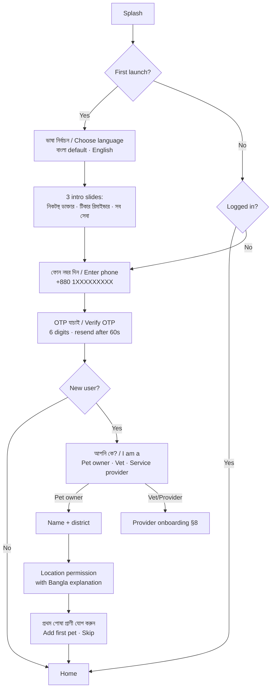
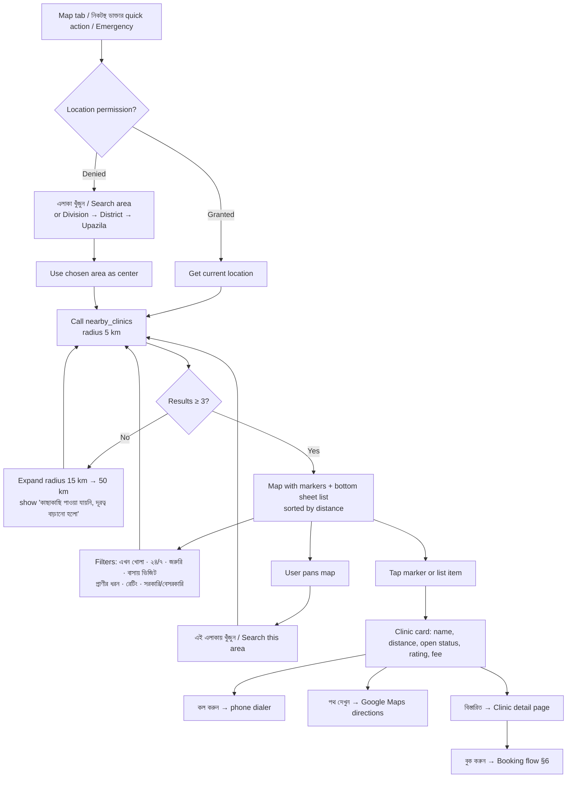
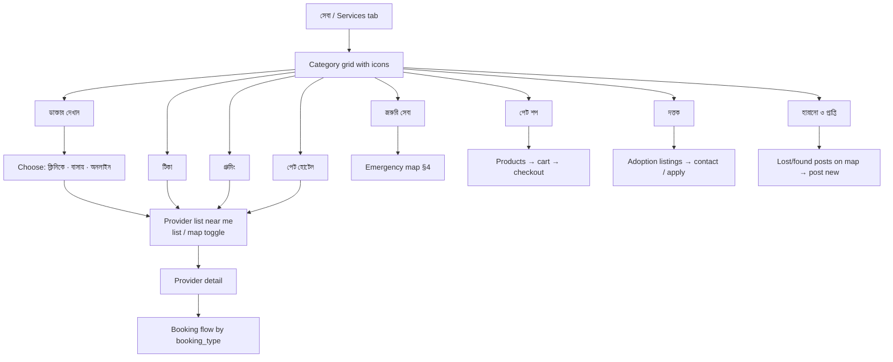
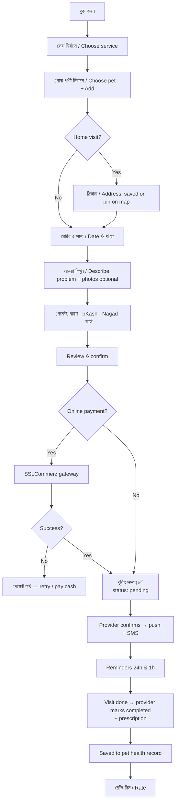
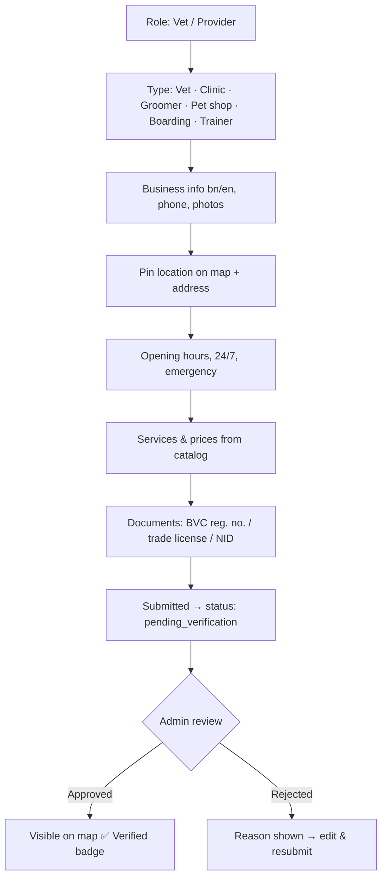

# Pranora — App Flow

Related: [prd.md](./prd.md) · [design.md](./design.md)

All screens exist on mobile app and website unless marked **(app)** or **(web)**. Labels are shown as `বাংলা / English`.

---

## 1. Navigation Map

### Pet owner — bottom tab bar (app) / top nav (web)

| Tab | বাংলা | Contents |
|---|---|---|
| Home | হোম | Greeting, my pets, upcoming reminders, quick actions, emergency button |
| Map | ম্যাপ | Nearest vets & services on map + list |
| Services | সেবা | All services catalog |
| Bookings | বুকিং | Upcoming / past appointments & orders |
| Profile | প্রোফাইল | My pets, health records, settings, language |

A red **জরুরি / Emergency** floating button is visible on Home and Map.

### Provider (vet / clinic / shop)
Dashboard · Bookings · Schedule · Services & Prices · Clinic Profile · Earnings · Reviews

### Admin (web only)
Overview · Provider Verification · Clinics · Users · Bookings · Content · Reports · Settings

---

## 2. Onboarding & Auth



---

## 3. Home

1. Greeting: "শুভ সকাল, রাফি 👋"
2. My pets carousel → tap to open pet profile; "+" to add
3. Upcoming reminders card (e.g. "মিনুর র‍্যাবিস টিকা — ৩ দিন বাকি") → **বুক করুন / Mark done**
4. Quick actions: নিকটস্থ ডাক্তার · অ্যাপয়েন্টমেন্ট · বাসায় ডাক্তার · পেট শপ · গ্রুমিং
5. Next booking card
6. Tips / articles (Bangla)
7. Emergency button

---

## 4. ⭐ Nearest Veterinary on Map



### Clinic detail page
Photos · Name (bn/en) · Verified badge · Distance & address · Open now / hours for the week · Doctors (with BVC reg. no.) · Services with prices · Species treated · Reviews · Buttons: **কল করুন**, **পথ দেখুন**, **বুক করুন**, **শেয়ার**, **ভুল তথ্য রিপোর্ট করুন**.

### Emergency mode
Red header "জরুরি সেবা" → only open-now / 24-7 clinics → nearest first → big **কল করুন** on each item → hotline numbers at bottom → optional "জরুরি অনুরোধ পাঠান" (sends request to nearby clinics that support it).

### Layers (P1)
Toggle chips on top of map: ডাক্তার · গ্রুমিং · পেট শপ · পেট হোটেল.

### Website differences
Split view: list on the left, map on the right (desktop). On mobile web it behaves like the app (map + draggable bottom sheet). URL keeps state for sharing/SEO: `/map?lat=23.74&lng=90.37&open=1&service=home_visit`, plus static SEO pages like `/vets/dhaka/dhanmondi`.

---

## 5. ⭐ Services Catalog



Each service page shows: what it is, price range, how it works (3 steps), providers near me, FAQs — all bilingual.

---

## 6. Booking Flow (appointment / home visit / vaccination / grooming)



Booking statuses: `pending → confirmed → in_progress → completed`; side exits `cancelled_by_owner`, `cancelled_by_provider`, `no_show`, `expired`.

---

## 7. Pet Profile & Health Records

```
প্রোফাইল → আমার পোষা প্রাণী → [Pet]
 ├─ Overview: photo, species, breed, age, weight, QR Pet ID
 ├─ টিকা / Vaccines: schedule (done ✅ / due ⏰ / overdue 🔴) → mark done / book
 ├─ চিকিৎসা ইতিহাস / Medical history: visits, prescriptions, reports (upload)
 ├─ রিমাইন্ডার / Reminders: add custom (medicine, deworming, grooming)
 ├─ ওজন / Weight chart
 └─ শেয়ার / Export PDF
```

Adding a pet auto-creates the vaccine schedule from `vaccine_templates` for that species and age.

---

## 8. Provider Onboarding & Dashboard



Dashboard: today's bookings · accept/decline · mark complete · write prescription · manage slots & days off · edit services/prices · earnings · reviews.

---

## 9. Settings

Language (বাংলা / English) · Notifications (push / SMS toggles) · Saved addresses · Payment methods · Privacy · Help & support (call / WhatsApp / FAQ) · Terms & privacy policy · Logout · Delete account.

---

## 10. Empty, Error & Offline States

| Case | Message (bn) | Action |
|---|---|---|
| No internet | ইন্টারনেট সংযোগ নেই | Show cached nearby list, retry |
| No clinics in radius | এই এলাকায় কোনো ক্লিনিক পাওয়া যায়নি | Expand radius, suggest a clinic |
| Location denied | লোকেশন ছাড়া এলাকা দিয়ে খুঁজুন | Area search |
| No pets yet | এখনো কোনো পোষা প্রাণী যোগ করা হয়নি | Add pet |
| Payment failed | পেমেন্ট সম্পন্ন হয়নি | Retry / pay cash |
| Server error | কিছু একটা সমস্যা হয়েছে | Retry, contact support |
