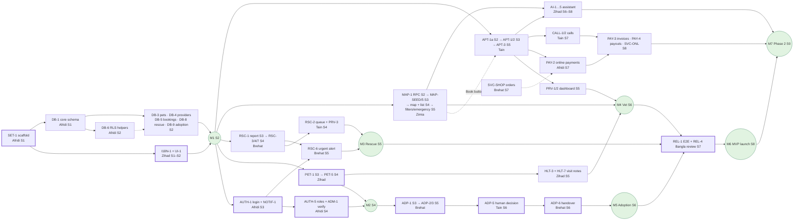

# Pranora — Work Schedule & Dependencies

Who works on what, when, and in which order, so the five members' parts fit together. Tasks, owners and sizes come from [tracker.md](./tracker.md) (the `Sprint` and `Depends on` columns there mirror this file). Ownership: [team.md](./team.md).

> ⚠️ **Proposed plan.** The team should confirm the start date and capacity. It is re-planned at every sprint review (§11). Dates shift together if the start moves.

---

## 1. Assumptions

| Item | Value | Why |
|---|---|---|
| Sprint length | **1 week** (Mon–Sun), S1 = 9 Nov 2026 | Many tasks hand off between members (e.g. Zihad's pet profile → Brehat's adoption listing → Tain's review screen → Brehat's handover). Each handoff waits for the sprint-end merge, so 1-week sprints cost one week per handoff instead of two. A weekly sync also suits a part-time student team. |
| Capacity | ~7 effort points per member per week; **6 planned**, ~1 kept for code review, integration fixes and contracts | Part-time students (6–8 points/week). Sizes: S = 1, M = 2, L = 3 points. |
| Team | 5 members, owners as in [team.md](./team.md) | No owner changes were needed (§9). |
| Phase 0 docs | DOC-1…8 are ✅ and not scheduled | — |

## 2. Dependency Rules

- **Hard dependency** (`ID` in the tracker): the task must be ✅ Done, i.e. **merged to `dev`**, before the dependent task starts.
  - Another member's task: it merges at the sprint-end checkpoint, so the dependent starts **next sprint**.
  - Your own task: you may chain it inside the same sprint.
  - Exception: **SET-1** (monorepo scaffold) is the gate for everything. Afridi merges it by **day 3 of S1**, and others start right after.
- **Soft dependency** (`(ID)` in the tracker): you can start as soon as the **contract** is agreed (§5) and code against a typed stub (§7). Your PR must **merge after** the provider's PR. Soft dependencies are planned in the same or an earlier sprint.
- **Phase 2 tasks** start only when the member's own MVP feature tasks are done. They land behind a feature flag (`app_config` key `feature.<name>`), stay **off in production** until the Phase 2 release, and MVP bugs always come first.
- **Phase 3 tasks** start only after the MVP launch and after the member's own Phase 2 tasks.

The schedule below was computed from these rules: every task's dependencies, owner capacity of 6 points per sprint, and critical-path-first priority.

---

## 3. Sprint Plan (sprint × member)

Points per member are in brackets. 🔵 = Phase 2 task behind a flag, ⚪ = Phase 3. Dates are proposed.

| Sprint | Dates | Zihad | Afridi | Zimia | Brehat | Tain |
|---|---|---|---|---|---|---|
| **S1** | 9–15 Nov | DES-1, I18N-1 [6] | SET-1 (by day 3), DB-1 [6] | SET-3 [1] + clinic data collection for MAP-SEED, map/clinic contracts | SET-2 [2] + rescue & adoption RPC contracts | SET-4 [2] + booking RPC & route contracts |
| **S2** | 16–22 Nov | UI-1, DB-3 [6] | DB-6, DB-2 [4] + auth/notify contracts | DB-4, MAP-1 [5] | DB-8, DB-9 [4] | DB-5, APT-1a [5] |
| **S3** | 23–29 Nov | PET-1, DB-7, SVC-1 [6] | NOTIF-1, AUTH-1 [6] | MAP-SEED, MAP-5, MAP-6 [6] | ADP-1, RSC-1, RSC-5 [6] | APT-1, APT-2, PAY-1 [6] |
| **S4** | 30 Nov–6 Dec | PET-5, HLT-1, REL-2 [6] | AUTH-5, ADM-1, AUTH-4, ADM-3 [6] | MAP-1a, MAP-1b, MAP-2 [6] | RSC-3, RSC-4, RSC-7 [5] | PRV-3, RSC-2 [5] |
| **S5** | 7–13 Dec | HLT-3, HLT-7, I18N-2 [6] | ADM-2, AUTH-3, 🔵HLT-2 [5] | MAP-3, MAP-7, SVC-2 [6] | ADP-2, ADP-3, RSC-6 [6] | APT-3, PRV-1, PRV-2 [6] |
| **S6** | 14–20 Dec | 🔵AI-1, 🔵AI-6 [6] | 🔵REV-2, 🔵HLT-6, 🔵ADM-4 [6] | REL-5, MAP-4, 🔵REV-1 [5] | ADP-6, ADP-4, 🔵ADP-9 [6] | ADP-5, APT-6, 🔵APT-5 [6] |
| **S7** | 21–27 Dec | REL-4, 🔵AI-2, 🔵AI-4, 🔵AI-3 [6] | REL-1, 🔵PAY-2 [6] | 🔵MAP-8/9, 🔵SVC-HOME, 🔵SVC-GRM [6] | 🔵SVC-SHOP, 🔵RSC-8, 🔵ADP-7 [6] | 🔵CALL-1, 🔵CALL-2 [6] |
| **S8** | 28 Dec–3 Jan | 🔵SVC-TIPS, 🔵AI-5 [3] | REL-3, 🔵PAY-3, 🔵PAY-4 [6] | 🔵SVC-BRD, 🔵MAP-11, 🔵MAP-10 [5] | 🔵RSC-9, 🔵RSC-10, 🔵ADP-8 [5] | 🔵SVC-ONL, 🔵APT-4, 🔵CALL-3 [4] |
| **S9** | 4–10 Jan | ⚪SVC-SIT [2] + Phase 2 hardening | ⚪SVC-TRN [2] + Phase 2 release | ⚪LIV-1, ⚪MAP-12 [4] | ⚪ADP-10 [3] + Phase 2 hardening | ⚪CALL-4, ⚪SVC-TAXI [4] |

**Spare capacity** is used for the following; nobody is idle:
- **S1:** Zimia, Brehat and Tain are lighter while the scaffold lands. They write their area's **contracts** (§5): RPC signatures in schema.md §5.3, Zod schemas and route params. Zimia also collects the clinic data for MAP-SEED.
- **S2:** Afridi writes the auth, roles and `notify()` contracts.
- **S7–S8 (MVP hardening):** everyone fixes REL-1 E2E failures first, and writes the E2E test for their own flow (REL-1 harness by Afridi).
- **S8–S9:** spare capacity goes to the Phase 2 release: payment sandbox tests, the AI guardrail eval set, and call tests.

Per-member totals are unchanged by the schedule and stay balanced (§9).

---

## 4. Milestones & Critical Path

| Milestone | Done when | Target |
|---|---|---|
| **M1 Foundation** | SET-1…4, DES-1, I18N-1, UI-1, DB-1…6, DB-8, DB-9 | end S2 |
| **M2 Accounts, roles & pets** | AUTH-1, AUTH-4, AUTH-5, NOTIF-1, ADM-1, PET-1, PET-5, HLT-1, DB-7, SVC-1 | end S4 |
| **M3 Rescue** | RSC-1…7, RSC-2, PRV-3, ADM-3 | end S5 |
| **M4 Vet map & booking** | MAP-1…7, MAP-SEED, SVC-2, APT-1a, APT-1/2/3/6, PAY-1, PRV-1/2, HLT-3, HLT-7 | end S6 |
| **M5 Adoption** | ADP-1…6, ADM-2 | end S6 |
| **M6 MVP launch** | AUTH-3, I18N-2, REL-1…5 → `dev` → `main`, stores + web | **end S8** (code freeze end S7) |
| **M7 Phase 2 release** | all P1 tasks, flags switched on | end S9 |
| **M8 Phase 3** | P2 tasks | from S9, re-planned after M7 |

### Critical path (MVP)

These tasks have **zero slack**: if one slips by a week, the MVP launch slips by a week.

```text
SET-1 (Afridi S1) → I18N-1 + UI-1 (Zihad S1–S2) → AUTH-1 (Afridi S3) ‖ PET-1 (Zihad S3)
→ AUTH-5 (Afridi S4) ‖ PET-5 (Zihad S4) → ADP-2 → ADP-3 (Brehat S5) → ADP-5 (Tain S6)
→ ADP-6 (Brehat S6) → REL-1 (Afridi S7) + REL-4 (Zihad S7) → REL-3 launch (Afridi S8)
```

- **Near-critical (1 sprint slack):**
  - booking: DB-5 → APT-1a → APT-1 → APT-2 → APT-3 (S5)
  - map: MAP-1 → MAP-2 → MAP-3 → MAP-7 (S5)
  - health: PET-1 → HLT-3 → HLT-7 (S5)
- **Rescue** (RSC-1 → RSC-3 → RSC-4 → RSC-7, done S4) has 2 sprints of slack.
- **Phase 2 critical path:** PAY-1 → PAY-2 (S7) → PAY-3 / PAY-4 / SVC-ONL (S8). Also CALL-1 → CALL-2 (S7) → SVC-ONL (S8).

Critical-path tasks get first claim on reviews. If one is at risk, others may **pair** on it, but the owner stays the same.

### Dependency diagram



In the diagram, solid arrows are hard dependencies, dotted arrows are soft (contract only), and thick borders mark the critical path.

---

## 5. Integration Points & Contracts

Wherever two members' work meets, the **provider** writes the contract first, the **consumer** reviews it, and both agree before the consumer starts. Each contract is one of:
- a table or column set (schema.md §4);
- an RPC signature (schema.md §5.3);
- TS/Zod types (`packages/validation`);
- a hook signature (`packages/api`);
- component props (`packages/ui`);
- route params.

It is written down in schema.md / trd.md, or as a §8 request in [team.md](./team.md). **Contract due** = the latest sprint by which it must be agreed.

| # | Integration | Provider → consumer(s) | Contract to agree first | Contract due | Integrated (checkpoint) |
|---|---|---|---|---|---|
| 1 | **i18n + UI kit used by every screen** | Zihad → everyone | `t()` + namespace files `locales/{bn,en}/<feature>.json`, formatters (`formatMoney`, `formatDate`, `formatDistance`, `formatNumber`), `pickLocale()`; props of `Button`, `Input`, `Card`, `ListItem`, `EmergencyButton`, `StateView` (loading/empty/error/offline/location-denied) | S1 | I18N-1 end S1, UI-1 end S2 |
| 2 | **Base schema** | Afridi (DB-1/DB-6) → all migrations | `profiles`, `user_roles`, locations, `addresses` as in schema.md §4.1–4.2; `has_role()` / `is_admin()` signatures | S1 (already in schema.md) | end S1 / end S2 |
| 3 | **Pets & providers tables** | Zihad (DB-3), Zimia (DB-4) → Tain (DB-5), Brehat (DB-8/9), Zihad (DB-7) | schema.md §4.3–4.5, incl. `pets.shelter_id` / `rescue_case_id` FKs added by DB-8 | S1 (already in schema.md) | end S2, merge order §6 |
| 4 | **Session & roles** | Afridi (AUTH-1, AUTH-5) → everyone | `packages/api/auth`: `useSession()`, `requireAuth()`, `useRoles()`; role request statuses for verification | S2 | AUTH-1 end S3, AUTH-5 end S4 |
| 5 | **Notifications** | Afridi (NOTIF-1) → Afridi (AUTH-1 OTP), Brehat (RSC-6), Tain (APT-2), Afridi (HLT-2) | `notify(user_id, template_key, data, channels[])` + template keys in bn/en; SMS function `send-sms` | S2 | end S3 (RSC-6 uses it in S5) |
| 6 | **Map ↔ booking** | Tain (APT-1) ↔ Zimia (MAP-5/6) | Booking entry route `/book?locationId=&vetId=&serviceId=`; `nearby_clinics` row type (Zimia) for the clinic card | S2 | end S3 |
| 7 | **Booking RPCs** | Tain (APT-1a) → Tain (APT-1, PRV-2), Zihad (AI-4), Zimia (SVC-HOME/GRM/BRD), Afridi (PAY-2) | `available_slots(location_id, vet_id, date)`, `create_booking(...)`, `cancel_booking` / `reschedule_booking`, booking status enum | S2 | end S2 (RPC), end S3 (flow) |
| 8 | **Pet picker & ownership transfer** | Zihad (PET-1, PET-5) → Tain (APT-1), Brehat (RSC-1 lost, ADP-2, ADP-6) | `PetPicker` props; `pets` read hooks; transfer function used by `complete_adoption_handover()` | S3 (PET-1), S4 (PET-5) | end S3 / end S4 |
| 9 | **Rescue workflow ↔ queues** | Brehat (RSC-1/3/4/7) → Tain (RSC-2, PRV-3), Afridi (ADM-3) | `review_animal_report`, `assign_rescuer`, `respond_to_assignment`, `close_rescue_case`, `my_report_status`; queue ordering (urgency desc) | S3 | end S4 |
| 10 | **Roles verification ↔ onboarding** | Afridi (AUTH-5, ADM-1) → Tain (PRV-1, PRV-3), Brehat (ADP-2) | `user_roles.status`, `provider_documents` flow, "verified lister" check | S3 | end S4 / S5 |
| 11 | **Adoption decision & handover** ⚠️ critical path | Brehat (ADP-3, ADP-6) ↔ Tain (ADP-5) ↔ Zihad (PET-5) | `decide_adoption_application(application_id, approve, note)` (human only), `confirm_handover(handover_id)`, application status enum | S4 | ADP-5 → ADP-6 within S6 (ADP-5 merges first) |
| 12 | **Visit notes in vet dashboard** | Zihad (HLT-3, HLT-7) → Tain (PRV-2) | `VisitNoteForm` props + medical-record insert (vet only) | S4 | end S5 |
| 13 | **Moderation** | Afridi (ADM-2, REV-2) ↔ Brehat (listings, reports), Zimia (clinic data, REV-1) | `content_reports` shape; remove/hide actions per table | S4 | end S5 (ADM-2), S8 (REV-2 → ADP-8) |
| 14 | **Reminders** | Afridi (HLT-2) → Tain (APT-4), Brehat (ADP-9), Afridi (HLT-6) | `reminders` rows + scheduler (pg_cron) contract | S5 | end S5 / S6 |
| 15 | **Payments** | Tain (PAY-1) → Afridi (PAY-2) → Tain (checkout), Brehat (SVC-SHOP online), Tain (SVC-ONL), Afridi (PAY-3/4) | `bookings.payment_method/status` (PAY-1); `payments` table + `PaymentProvider` interface (`createSession`, `validateIpn`, `refund`) with a mock provider; `orders` shape from SVC-SHOP | S6 | PAY-2 end S7 (shop orders land first in S7), PAY-3/4 end S8 |
| 16 | **Calls ↔ booking** | Tain (CALL-1/2) → Tain (SVC-ONL), Zihad (AI-5) | `call_sessions` linked to `booking_id`; `calls-create` function | S6 | end S7 |
| 17 | **AI ↔ search & booking** | Zimia (MAP-1/7), Tain (APT-1a) → Zihad (AI-2/4) | AI calls `nearby_clinics` and `create_booking` only after an explicit "হ্যাঁ / Yes"; emergency deep link to MAP-7 | S6 | end S7 |
| 18 | **CI & E2E** | Tain (SET-4), Afridi (REL-1) → everyone | CI jobs (lint, typecheck, unit, `supabase db reset`, pgTAP); E2E harness; each owner adds their flow test | S1 / S6 | every checkpoint; full E2E end S7 |
| 19 | **App shells & navigation** | Afridi + Zihad → everyone | One nav entry per feature in the shared layouts | S2 | each sprint, one nav PR at a time |

If a contract is late, the consumer marks the task ⛔ Blocked in the tracker, names the provider, and raises it at the next daily sync.

---

## 6. Branches, Merge Order & Checkpoints

```text
<member>/<task-id>-name ─┐
member branch (zihad, afridi, Zimia, brehat, tain) ─┴─► PR into dev ─► staging (Supabase staging)
                                                                 └─► release PR dev → main (Afridi) ─► production
```

- **`dev`** is the integration branch. Every task merges into `dev` through a PR with CODEOWNERS review and green CI.
  - Any approving CODEOWNER may merge into `dev`, following the order below.
  - Only Afridi merges `dev` → `main`, at milestones/releases (M6, M7, …).
- **Sync cadence:** rebase (or merge) from `dev` at **sprint start** (Monday) and **every day before you push**, and always right before opening a PR. Never let a branch fall more than 2 days behind `dev`.
- **Sprint-end checkpoint** (last day of the sprint):
  1. Merge in the order below.
  2. Run `supabase db reset` + pgTAP + smoke/E2E on staging.
  3. Hold a short demo.
  4. Update tracker statuses.
  5. Plan the next sprint (§11).
- **Merge order** inside a sprint: contract/provider PRs first, then consumers. Migrations before RPCs before UI.

| Sprint | Merge first → last |
|---|---|
| S1 | SET-1 (day 3) → SET-2 (`supabase/config`) → SET-4 (CI) → DB-1 → I18N-1 |
| S2 | DB-6 → DB-2 → DB-3 → DB-4 → DB-5 → DB-8 → DB-9 → MAP-1 → APT-1a → UI-1 |
| S3 | NOTIF-1 → AUTH-1 → PET-1 → DB-7 → SVC-1 → MAP-SEED → MAP-5 → APT-1 → APT-2 → PAY-1 → MAP-6 → RSC-1 → RSC-5 → ADP-1 |
| S4 | AUTH-5 → ADM-1 → PRV-3 → RSC-2 → RSC-3 → RSC-4 → RSC-7 → ADM-3 → PET-5 → HLT-1 → AUTH-4 → MAP-1a/1b → MAP-2 |
| S5 | HLT-3 → HLT-7 → I18N-2 → AUTH-3 → PRV-1 → PRV-2 → APT-3 → ADP-2 → ADP-3 → RSC-6 → MAP-3 → MAP-7 → SVC-2 → ADM-2 |
| S6 | ADP-5 → ADP-6 → ADP-4 → APT-6 → MAP-4 → REL-5, then flagged 🔵 work |
| S7 | **Code freeze for MVP** (fixes only on MVP code). REL-1 → REL-4 fixes; then 🔵 SVC-SHOP → PAY-2, CALL-1 → CALL-2 |
| S8 | `dev` → `main` release PR (REL-3); then 🔵 REV-2 → ADP-8, PAY-3/PAY-4, SVC-ONL |

### Migration naming & ordering

- File name: `YYYYMMDDHHMMSS_<area>_<description>.sql`, where `<area>` is your area prefix from [team.md §2](./team.md#2-proposed-ownership-split-paths).
- **The timestamp is set when you merge, not when you start.** Right before merging, rebase on `dev`. If any migration on `dev` is newer than yours, rename your file to the current UTC time, then run `supabase db reset` + pgTAP locally.
- **One migration PR merges at a time.** CI runs `supabase db reset` on the merged result. Regenerate `packages/types` (`pnpm db:types`) in the same PR. On a types conflict, regenerate after rebasing; never hand-merge.
- Never edit a migration that is already on `dev`. Add a new one instead.
- FKs into another area's table (e.g. DB-8 adds `pets.rescue_case_id` FK) go in **your** migration, after the other area's migration has merged.

---

## 7. Contract-First & Stubs

So that soft dependencies don't block anyone:

1. **Contract PR first (provider):** the provider merges a small PR into `dev` **in their own area**, containing:
   - the Zod schema / TS types;
   - the hook or function signature in `packages/api/src/<area>`, returning typed fixtures or throwing `NotImplemented`;
   - the RPC signature in schema.md §5.3.

   Consumers then import the **real path**, and nothing has to change when the implementation lands.
2. **Consumer stubs** (only if the contract PR isn't merged yet): put a typed fake in your own feature folder (`features/<feature>/__stubs__/`). Delete it in the PR that switches to the real import. Never put a stub inside another member's area.
3. **Database:** schema.md is the table contract. Seed/test data for other areas lives in your own pgTAP test setup, not in their seed files.
4. **Payments:** PAY-2 starts with a `PaymentProvider` interface and a **mock provider**, so checkout can be built and tested first. SSLCommerz is plugged in later. Only the server-side IPN marks a payment as paid, even with the mock.
5. **UI:** UI-1 ships the component API with simple placeholder implementations first, plus a dev-only gallery page. Feature screens use them from S3, and the visual polish follows without API changes.
6. **Feature flags:** Phase 2 work merged before launch is wrapped in `app_config` flags (`feature.payments_online`, `feature.ai_chat`, `feature.calls`, `feature.shop`, …), default **off** in production.

---

## 8. Parallel-Safe vs Must-Not-Run-in-Parallel

**Safe to run at the same time:** these are different owners and different files.
- **S2 migrations:** DB-3, DB-4, DB-5, DB-6, DB-8 and DB-9 are written in parallel because schema.md is the contract. Only their **merge** is sequential (§6).
- **Feature UI in different features:** for example S3 PET-1 / MAP-5 / APT-1 / RSC-1 / ADP-1 / AUTH-1. Each owner uses their own folder and i18n namespace.
- **Web vs app versions of the same feature by one owner:** e.g. MAP-1a and MAP-1b.
- **Phase 2 work in different modules:** AI (Zihad), calls (Tain), shop (Brehat), grooming/boarding (Zimia), reminders/payments (Afridi).

**Do NOT run in parallel.** Sequence these, or have one person do them:

| What | Why | Rule |
|---|---|---|
| Two migration PRs merging at once | Ordering and FK conflicts, broken `db reset` | One migration PR at a time, in the §6 order |
| `packages/types` edits | Generated file, conflicts | Only via `pnpm db:types` in the migration PR |
| Root `package.json` / `pnpm-lock.yaml` | Lockfile conflicts | One dependency PR at a time; on conflict, re-run `pnpm install` after rebasing; never hand-merge |
| `common.json` (bn/en) and app shell layouts | Shared files | Append-only; one nav-entry PR at a time (Afridi + Zihad approve) |
| AUTH-5 → ADM-1 → PRV-1 / ADP-2 | All touch role verification (`user_roles.status`) | In this order |
| PET-5 → ADP-6 | Both change pet ownership | PET-5 first; ADP-6 calls it |
| ADP-5 → ADP-6 | Handover needs an approved application | ADP-5 merges first (same sprint S6) |
| PAY-1 → PAY-2 → PAY-3 / PAY-4 / SVC-ONL; SVC-SHOP → shop online checkout | No payment without something to pay for | In this order |
| HLT-2 → HLT-6, APT-4, ADP-9 | One reminder scheduler | HLT-2 first |
| One owner's chain (e.g. APT-1a → APT-1 → APT-2 → APT-3) | Same files | Sequential by the owner |

---

## 9. Ownership & Balance

No owners were changed: the computed plan keeps everyone busy within the rules above. One task was added: **UI-1** (design tokens + base components, Zihad), because every screen depends on it.

| Member | Phase 0 (open) | MVP | Phase 2 | Phase 3 | Total tasks | Effort points |
|---|---|---|---|---|---|---|
| Zihad | 1 | 13 | 7 | 1 | 22 | 47 |
| Afridi | 1 | 13 | 7 | 1 | 22 | 47 |
| Zimia | 1 | 13 | 7 | 2 | 23 | 44 |
| Brehat | 1 | 13 | 7 | 1 | 22 | 43 |
| Tain | 1 | 12 | 6 | 2 | 21 | 44 |
| **Total** | **5** | **64** | **34** | **7** | **110** | **225** |

Same numbers as [team.md §4](./team.md#4-workload-balance).

---

## 10. External Lead-Time Items (start in S1)

These depend on outside parties and can take weeks, so start them in S1.

| Item | Needed by | Owner |
|---|---|---|
| SMS gateway account + sender ID (OTP, urgent alerts) | AUTH-1 / NOTIF-1, S3 | Afridi |
| Google Maps billing + restricted keys | SET-3, S1 | Zimia |
| Clinic data source (DLS list, partner clinics) | MAP-SEED, S3 | Zimia |
| Licensed vet reviewer | REL-5, S6 | Zimia |
| Native Bangla reviewer | REL-4, S7 | Zihad |
| Google Play + Apple developer accounts, domain pranora.com.bd | REL-3, S8 (Apple review takes days — submit early in S8) | Afridi |
| SSLCommerz merchant account (bKash, Nagad, Rocket, cards) | PAY-2, S7 | Afridi |
| AI vendor with good Bangla + speech-to-text / text-to-speech | AI-1 / AI-6, S6 | Zihad |
| Calls vendor (Agora / Daily.co) | CALL-1, S7 | Tain |

---

## 11. Re-planning

- **Every sprint end:** mark statuses in the tracker. A task that isn't ✅ moves to the next sprint, and so do its dependents. Check whether it is on the critical path (§4); if so, the launch date moves or someone pairs on it.
- **New tasks:** add them to the tracker with Owner, Size, `Depends on` and a Sprint that is after all their hard dependencies, then update this file and team.md §4.
- Zihad keeps this file, the tracker `Sprint`/`Depends on` columns and the summary counts in sync.
