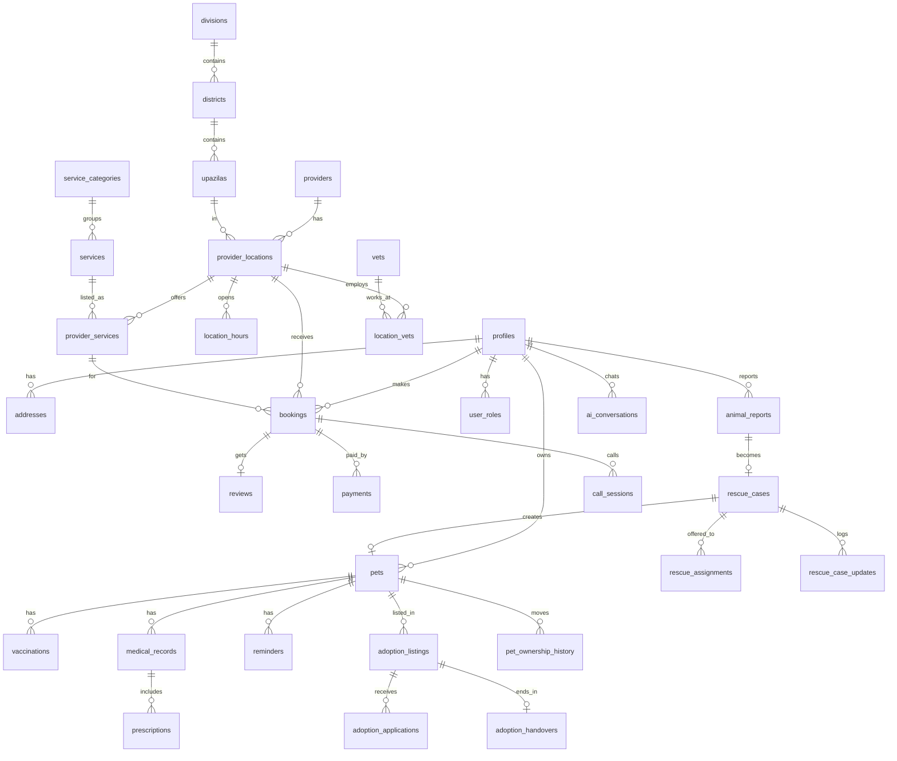

# Pranora — Backend Schema Document

Database: **Supabase PostgreSQL 15 + PostGIS**. Source of truth is `supabase/migrations/`; this document explains the design.
Related: [trd.md](./trd.md)

---

## 1. Conventions

- Table names: `snake_case`, plural. Primary keys: `id uuid default gen_random_uuid()`.
- Every table has `created_at timestamptz default now()`; mutable tables also have `updated_at` (trigger `set_updated_at`).
- Bilingual text: `name_bn`, `name_en` (at least one required). Clients pick by locale with fallback.
- Money: `numeric(10,2)` in BDT (৳).
- Time zone: store `timestamptz`; business hours as `time` interpreted in **Asia/Dhaka**.
- Soft delete where needed: `deleted_at timestamptz`.
- **RLS enabled on every table.**

---

## 2. Extensions

```sql
create extension if not exists postgis;
create extension if not exists pg_trgm;   -- fuzzy search (bn/en names)
create extension if not exists pg_cron;   -- reminders
```

---

## 3. Enums

```sql
create type user_role        as enum ('owner', 'rescuer', 'shelter', 'adoption_lister', 'vet', 'provider', 'admin');
create type app_locale       as enum ('bn', 'en');
create type species_type     as enum ('dog', 'cat', 'bird', 'rabbit', 'fish', 'cow', 'goat', 'poultry', 'other');
create type pet_gender       as enum ('male', 'female', 'unknown');
create type provider_type    as enum ('vet_clinic', 'pet_hospital', 'govt_vet_hospital', 'freelance_vet',
                                      'groomer', 'pet_shop', 'boarding', 'trainer', 'sitter', 'pet_taxi', 'shelter');
create type verification_status as enum ('draft', 'pending', 'verified', 'rejected', 'suspended');
create type schedule_mode    as enum ('slot', 'serial');           -- hourly slots or সিরিয়াল numbers
create type booking_type     as enum ('slot', 'serial', 'home_visit', 'online', 'date_range', 'order', 'instant', 'listing');
create type booking_status   as enum ('pending', 'confirmed', 'in_progress', 'completed',
                                      'cancelled_by_owner', 'cancelled_by_provider', 'no_show', 'expired');
create type payment_method   as enum ('cash', 'bkash', 'nagad', 'rocket', 'card');
create type payment_status   as enum ('pending', 'paid', 'failed', 'refunded');
create type reminder_type    as enum ('vaccine', 'deworming', 'flea_tick', 'medicine', 'grooming', 'checkup', 'custom');
create type order_status     as enum ('placed', 'confirmed', 'shipped', 'delivered', 'cancelled', 'returned');

-- Adoption
create type adoption_listing_status     as enum ('draft', 'available', 'reserved', 'adopted', 'withdrawn', 'removed');
create type adoption_application_status as enum ('submitted', 'under_review', 'approved', 'rejected', 'withdrawn');
create type home_type                   as enum ('own_house', 'rented_house', 'own_flat', 'rented_flat', 'other');

-- Rescue
create type animal_report_kind as enum ('injured', 'lost', 'found', 'abandoned');  -- lost & found is part of rescue
create type urgency_level      as enum ('low', 'medium', 'high', 'critical');
create type rescue_status      as enum ('submitted', 'under_review', 'assigned', 'rescue_in_progress',
                                        'closed', 'rejected', 'duplicate');
create type assignment_status  as enum ('offered', 'accepted', 'declined', 'withdrawn');
create type rescue_outcome     as enum ('treated', 'sent_to_shelter', 'adopted', 'returned_to_owner',
                                        'released', 'died', 'not_found', 'other');

-- Moderation, AI, calls
create type report_target   as enum ('adoption_listing', 'animal_report', 'review', 'provider', 'user');
create type moderation_status as enum ('open', 'actioned', 'dismissed');
create type call_kind       as enum ('audio', 'video');
create type call_status     as enum ('ringing', 'ongoing', 'ended', 'missed', 'declined', 'failed');
```

The reporter-facing rescue status is a simplified mapping of `rescue_status`: `submitted` → জমা, `under_review`/`assigned` → দেখা হচ্ছে, `rescue_in_progress` → উদ্ধার চলছে, `closed`/`rejected`/`duplicate` → শেষ.

---

## 4. Tables

### 4.1 Locations (Bangladesh admin areas)

```sql
create table divisions (
  id smallint primary key,
  name_bn text not null,
  name_en text not null
);

create table districts (
  id smallint primary key,
  division_id smallint not null references divisions(id),
  name_bn text not null,
  name_en text not null
);

create table upazilas (
  id integer primary key,
  district_id smallint not null references districts(id),
  name_bn text not null,
  name_en text not null,
  center geography(Point, 4326)
);
```
Seeded with 8 divisions, 64 districts and all upazilas/thanas.

### 4.2 Users

```sql
create table profiles (
  id uuid primary key references auth.users(id) on delete cascade,
  full_name text,
  phone text unique,                 -- +8801XXXXXXXXX (login by phone OTP or email)
  email text unique,
  avatar_url text,
  locale app_locale not null default 'bn',
  district_id smallint references districts(id),
  push_token text,
  sms_opt_in boolean not null default true,
  created_at timestamptz not null default now(),
  updated_at timestamptz not null default now()
);

create table addresses (
  id uuid primary key default gen_random_uuid(),
  user_id uuid not null references profiles(id) on delete cascade,
  label text,                        -- বাসা / অফিস
  address_line text not null,
  upazila_id integer references upazilas(id),
  location geography(Point, 4326),
  is_default boolean not null default false,
  created_at timestamptz not null default now()
);

-- One person can hold several roles (e.g. owner + rescuer).
create table user_roles (
  user_id uuid not null references profiles(id) on delete cascade,
  role user_role not null,
  status verification_status not null default 'verified',   -- 'owner' is auto-verified; others start 'pending'
  verified_by uuid references profiles(id),
  verified_at timestamptz,
  created_at timestamptz not null default now(),
  primary key (user_id, role)
);

-- Rescuer availability & area (RSC-9, P1)
create table rescuer_profiles (
  user_id uuid primary key references profiles(id) on delete cascade,
  base_location geography(Point, 4326),
  district_id smallint references districts(id),
  radius_km numeric(4,1) not null default 5,
  species species_type[] not null default '{dog,cat}',
  is_available boolean not null default true,
  updated_at timestamptz not null default now()
);

create index rescuer_profiles_location_gix on rescuer_profiles using gist (base_location);
```

### 4.3 Pets

```sql
create table breeds (
  id serial primary key,
  species species_type not null,
  name_bn text,
  name_en text not null
);

create table pets (
  id uuid primary key default gen_random_uuid(),
  owner_id uuid not null references profiles(id) on delete cascade,  -- current owner or custodian (rescuer / shelter staff)
  shelter_id uuid,                   -- FK to providers(id), added in §4.10; set while a shelter holds the animal
  name text not null,
  species species_type not null,
  breed_id integer references breeds(id),
  breed_other text,
  gender pet_gender not null default 'unknown',
  date_of_birth date,
  weight_kg numeric(5,2),
  color text,
  photo_url text,
  microchip_no text,
  is_neutered boolean,
  allergies text,
  public_qr_slug text unique,        -- for lost-pet QR ID card
  rescue_case_id uuid,               -- FK to rescue_cases(id), added in §4.10; same profile for life (PET-5)
  deleted_at timestamptz,
  created_at timestamptz not null default now(),
  updated_at timestamptz not null default now()
);

create table pet_weights (
  id uuid primary key default gen_random_uuid(),
  pet_id uuid not null references pets(id) on delete cascade,
  weight_kg numeric(5,2) not null,
  measured_on date not null default current_date
);

-- Ownership history; written by complete_adoption_handover() and rescue intake
create table pet_ownership_history (
  id uuid primary key default gen_random_uuid(),
  pet_id uuid not null references pets(id) on delete cascade,
  from_user_id uuid references profiles(id),
  to_user_id uuid not null references profiles(id),
  reason text not null check (reason in ('registered', 'rescue_intake', 'adoption', 'admin_transfer')),
  created_at timestamptz not null default now()
);
```

### 4.4 Providers, Clinics & Map Data

`providers` = any business (clinic, groomer, shop…). Each has one or more `provider_locations` (branches) that appear on the map.

```sql
create table providers (
  id uuid primary key default gen_random_uuid(),
  owner_user_id uuid not null references profiles(id),
  type provider_type not null,
  name_bn text,
  name_en text,
  description_bn text,
  description_en text,
  logo_url text,
  phone text not null,
  whatsapp text,
  email text,
  website text,
  trade_license_no text,
  is_government boolean not null default false,
  verification verification_status not null default 'draft',
  verified_at timestamptz,
  rating_avg numeric(2,1) not null default 0,
  rating_count integer not null default 0,
  created_at timestamptz not null default now(),
  updated_at timestamptz not null default now(),
  check (name_bn is not null or name_en is not null)
);

create table provider_locations (
  id uuid primary key default gen_random_uuid(),
  provider_id uuid not null references providers(id) on delete cascade,
  name_bn text,                      -- branch name, optional
  name_en text,
  address_bn text,
  address_en text,
  upazila_id integer references upazilas(id),
  location geography(Point, 4326) not null,
  phone text,
  is_24h boolean not null default false,
  has_emergency boolean not null default false,
  offers_home_visit boolean not null default false,
  home_visit_radius_km numeric(4,1),
  species_treated species_type[] not null default '{dog,cat}',
  photos text[] not null default '{}',
  cancel_cutoff_hours smallint not null default 2,   -- owners can cancel/reschedule until this many hours before (APT-3)
  is_active boolean not null default true,
  created_at timestamptz not null default now(),
  updated_at timestamptz not null default now()
);

create index provider_locations_location_gix on provider_locations using gist (location);
create index provider_locations_upazila_idx  on provider_locations (upazila_id);

create table location_hours (
  id uuid primary key default gen_random_uuid(),
  location_id uuid not null references provider_locations(id) on delete cascade,
  weekday smallint not null check (weekday between 0 and 6),  -- 0 = Sunday
  open_time time not null,
  close_time time not null,          -- if close < open, closes after midnight
  unique (location_id, weekday, open_time)
);

create table vets (
  id uuid primary key default gen_random_uuid(),
  user_id uuid unique references profiles(id),
  full_name_bn text,
  full_name_en text not null,
  bvc_reg_no text unique,            -- Bangladesh Veterinary Council registration
  degrees text,                      -- DVM, MS ...
  specialization text,
  experience_years smallint,
  photo_url text,
  consultation_fee numeric(10,2),
  online_consult boolean not null default false,
  verification verification_status not null default 'draft',
  created_at timestamptz not null default now()
);

create table location_vets (
  location_id uuid references provider_locations(id) on delete cascade,
  vet_id uuid references vets(id) on delete cascade,
  primary key (location_id, vet_id)
);

create table provider_documents (
  id uuid primary key default gen_random_uuid(),
  provider_id uuid references providers(id) on delete cascade,
  vet_id uuid references vets(id) on delete cascade,
  doc_type text not null,            -- bvc_certificate, trade_license, nid
  file_path text not null,           -- private bucket
  status verification_status not null default 'pending',
  reviewed_by uuid references profiles(id),
  review_note text,
  created_at timestamptz not null default now()
);

create table clinic_suggestions (
  id uuid primary key default gen_random_uuid(),
  suggested_by uuid references profiles(id),
  name text not null,
  phone text,
  address text,
  location geography(Point, 4326),
  status verification_status not null default 'pending',
  created_at timestamptz not null default now()
);
```

### 4.5 Services Catalog

```sql
create table service_categories (
  id smallserial primary key,
  slug text unique not null,         -- vet, vaccination, grooming, shop, boarding ...
  name_bn text not null,
  name_en text not null,
  icon text,
  sort_order smallint not null default 0
);

create table services (
  id serial primary key,
  category_id smallint not null references service_categories(id),
  slug text unique not null,         -- clinic_visit, home_visit, online_consult, rabies_vaccine, bath_groom ...
  name_bn text not null,
  name_en text not null,
  description_bn text,
  description_en text,
  booking_type booking_type not null,
  is_active boolean not null default true
);

create table provider_services (
  id uuid primary key default gen_random_uuid(),
  location_id uuid not null references provider_locations(id) on delete cascade,
  service_id integer not null references services(id),
  price numeric(10,2),
  price_max numeric(10,2),           -- for ranges
  duration_min smallint,
  species species_type[],
  is_active boolean not null default true,
  unique (location_id, service_id)
);
```

### 4.6 Scheduling & Bookings

```sql
create table availability_rules (
  id uuid primary key default gen_random_uuid(),
  location_id uuid not null references provider_locations(id) on delete cascade,
  vet_id uuid references vets(id),
  weekday smallint not null check (weekday between 0 and 6),
  start_time time not null,
  end_time time not null,
  mode schedule_mode not null default 'slot',
  slot_minutes smallint not null default 20,        -- mode = 'slot'
  capacity smallint not null default 1,             -- mode = 'slot'
  max_serials smallint,                             -- mode = 'serial': serial numbers 1..max_serials per session
  check (mode = 'slot' or max_serials is not null)
);

-- Holidays / days off (APT-6)
create table availability_exceptions (
  id uuid primary key default gen_random_uuid(),
  location_id uuid not null references provider_locations(id) on delete cascade,
  vet_id uuid references vets(id),
  date date not null,
  is_closed boolean not null default true,
  note text
);

create table bookings (
  id uuid primary key default gen_random_uuid(),
  code text unique not null,         -- PRN-24K7Q9 (shown to users)
  owner_id uuid not null references profiles(id),
  pet_id uuid references pets(id),
  location_id uuid not null references provider_locations(id),
  vet_id uuid references vets(id),
  provider_service_id uuid not null references provider_services(id),
  type booking_type not null,
  status booking_status not null default 'pending',
  starts_at timestamptz,             -- slot start, or session start for serial bookings
  ends_at timestamptz,
  serial_no smallint,                -- সিরিয়াল number when type = 'serial'
  address_id uuid references addresses(id),       -- home visit
  problem_note text,
  attachments text[] not null default '{}',
  price numeric(10,2),
  payment_method payment_method not null default 'cash',
  payment_status payment_status not null default 'pending',
  cancel_reason text,
  created_at timestamptz not null default now(),
  updated_at timestamptz not null default now()
);

create index bookings_owner_idx    on bookings (owner_id, starts_at desc);
create index bookings_location_idx on bookings (location_id, starts_at);
create unique index bookings_no_double_slot
  on bookings (vet_id, starts_at)
  where status in ('pending', 'confirmed') and vet_id is not null and serial_no is null;
create unique index bookings_no_double_serial
  on bookings (location_id, vet_id, starts_at, serial_no)
  where status in ('pending', 'confirmed') and serial_no is not null;
```

### 4.7 Health Records

```sql
create table vaccine_templates (
  id serial primary key,
  species species_type not null,
  name_bn text not null,
  name_en text not null,             -- Rabies, DHPP, FVRCP ...
  first_dose_age_weeks smallint not null,
  repeat_every_days integer,         -- null = once
  doses smallint not null default 1
);

create table vaccinations (
  id uuid primary key default gen_random_uuid(),
  pet_id uuid not null references pets(id) on delete cascade,
  template_id integer references vaccine_templates(id),
  name text not null,
  due_date date,
  given_date date,
  given_by_vet_id uuid references vets(id),
  batch_no text,
  booking_id uuid references bookings(id),
  certificate_path text,
  created_at timestamptz not null default now()
);

-- Written only by vets (HLT-3, HLT-7); owners can read
create table medical_records (
  id uuid primary key default gen_random_uuid(),
  pet_id uuid not null references pets(id) on delete cascade,
  booking_id uuid references bookings(id),
  rescue_case_id uuid,               -- FK to rescue_cases(id), added in §4.10; treatment during a rescue
  vet_id uuid not null references vets(id),
  visit_date date not null default current_date,
  findings text,                     -- visit note: what the vet found
  diagnosis text,
  treatment text,                    -- visit note: what treatment was given
  notes text,
  attachments text[] not null default '{}',     -- private storage paths
  created_by uuid not null references profiles(id),
  created_at timestamptz not null default now()
);

-- Owner-uploaded old reports / lab results, shown as "Uploaded by owner", never mixed with vet records
create table pet_documents (
  id uuid primary key default gen_random_uuid(),
  pet_id uuid not null references pets(id) on delete cascade,
  uploaded_by uuid not null references profiles(id),
  title text,
  file_path text not null,           -- private `medical` bucket
  document_date date,
  created_at timestamptz not null default now()
);

create table prescriptions (
  id uuid primary key default gen_random_uuid(),
  medical_record_id uuid not null references medical_records(id) on delete cascade,
  medicine text not null,
  dosage text,
  frequency text,
  duration_days smallint,
  instructions text
);

create table reminders (
  id uuid primary key default gen_random_uuid(),
  pet_id uuid not null references pets(id) on delete cascade,
  owner_id uuid not null references profiles(id) on delete cascade,
  type reminder_type not null,
  title text not null,
  remind_at timestamptz not null,
  repeat_days integer,
  vaccination_id uuid references vaccinations(id) on delete cascade,
  is_done boolean not null default false,
  last_sent_at timestamptz,
  created_at timestamptz not null default now()
);

create index reminders_due_idx on reminders (remind_at) where is_done = false;
```

### 4.8 Shop & Orders (Phase 2)

```sql
create table products (
  id uuid primary key default gen_random_uuid(),
  provider_id uuid not null references providers(id) on delete cascade,
  name_bn text, name_en text,
  description_bn text, description_en text,
  category text not null,            -- food, medicine, accessories, toys
  species species_type[],
  price numeric(10,2) not null,
  sale_price numeric(10,2),
  stock integer not null default 0,
  images text[] not null default '{}',
  requires_prescription boolean not null default false,
  is_active boolean not null default true,
  created_at timestamptz not null default now()
);

create table orders (
  id uuid primary key default gen_random_uuid(),
  code text unique not null,
  owner_id uuid not null references profiles(id),
  provider_id uuid not null references providers(id),
  address_id uuid not null references addresses(id),
  status order_status not null default 'placed',
  subtotal numeric(10,2) not null,
  delivery_fee numeric(10,2) not null default 0,
  total numeric(10,2) not null,
  payment_method payment_method not null default 'cash',
  payment_status payment_status not null default 'pending',
  created_at timestamptz not null default now()
);

create table order_items (
  id uuid primary key default gen_random_uuid(),
  order_id uuid not null references orders(id) on delete cascade,
  product_id uuid not null references products(id),
  quantity integer not null check (quantity > 0),
  unit_price numeric(10,2) not null
);
```

### 4.9 Payments

```sql
create table payments (
  id uuid primary key default gen_random_uuid(),
  booking_id uuid references bookings(id),
  order_id uuid references orders(id),
  user_id uuid not null references profiles(id),
  amount numeric(10,2) not null,
  method payment_method not null,
  status payment_status not null default 'pending',
  gateway text,                      -- sslcommerz, bkash
  gateway_tran_id text unique,
  gateway_val_id text,
  raw_response jsonb,
  created_at timestamptz not null default now(),
  check (booking_id is not null or order_id is not null)
);
```

### 4.10 Rescue & Adoption

```sql
-- ---------- Rescue (RSC-*) ----------
create table animal_reports (
  id uuid primary key default gen_random_uuid(),
  reporter_id uuid not null references profiles(id),
  kind animal_report_kind not null,
  pet_id uuid references pets(id),                   -- kind = 'lost': the owner's own pet profile
  species species_type not null default 'other',
  urgency urgency_level not null,
  last_seen_at timestamptz,                          -- lost / found
  contact_phone text,                                -- lost / found; never public, shared with a responder only by the reporter
  description text,
  photos text[] not null default '{}',               -- private `rescue-media` bucket, EXIF stripped
  location geography(Point, 4326) not null,          -- exact; never public
  area_text text,                                    -- "মিরপুর ১০, গোল চত্বরের পাশে"
  upazila_id integer references upazilas(id),
  district_id smallint references districts(id),
  status rescue_status not null default 'submitted',
  duplicate_of uuid references animal_reports(id),   -- RSC-8 merge
  reviewed_by uuid references profiles(id),
  reviewed_at timestamptz,
  created_at timestamptz not null default now(),
  updated_at timestamptz not null default now()
);

-- urgency enum order is low < … < critical, so "desc" puts urgent reports first (RSC-2)
create index animal_reports_queue_idx    on animal_reports (status, urgency desc, created_at);
create index animal_reports_location_gix on animal_reports using gist (location);

-- Public lost & found board (RSC-10, P1): no phone number, no reporter, location snapped to a ~1 km grid.
-- Owned by the migration role, so it reads past animal_reports RLS by design.
create view lost_found_board as
select id, kind, species, description, photos, last_seen_at, created_at,
       st_snaptogrid(location::geometry, 0.01)::geography as approx_location
from animal_reports
where kind in ('lost', 'found')
  and status not in ('closed', 'rejected', 'duplicate');

grant select on lost_found_board to anon, authenticated;

create table rescue_cases (
  id uuid primary key default gen_random_uuid(),
  report_id uuid not null unique references animal_reports(id),
  status rescue_status not null default 'under_review',
  shelter_id uuid references providers(id),          -- reviewing / receiving shelter
  assigned_rescuer_id uuid references profiles(id),  -- set when an assignment is accepted
  pet_id uuid references pets(id),                   -- profile created for the animal (PET-5)
  outcome rescue_outcome,
  outcome_note text,
  closed_at timestamptz,
  created_at timestamptz not null default now(),
  updated_at timestamptz not null default now(),
  check (status <> 'closed' or outcome is not null)  -- RSC-7
);

create table rescue_assignments (
  id uuid primary key default gen_random_uuid(),
  case_id uuid not null references rescue_cases(id) on delete cascade,
  rescuer_id uuid not null references profiles(id),
  assigned_by uuid not null references profiles(id),
  status assignment_status not null default 'offered',
  decline_reason text,
  responded_at timestamptz,
  created_at timestamptz not null default now()
);

-- one rescuer per case at a time (RSC-3)
create unique index rescue_assignments_one_active
  on rescue_assignments (case_id) where status in ('offered', 'accepted');

create table rescue_case_updates (
  id uuid primary key default gen_random_uuid(),
  case_id uuid not null references rescue_cases(id) on delete cascade,
  author_id uuid not null references profiles(id),
  status rescue_status,                              -- set when the update changes the status
  note text,
  photos text[] not null default '{}',
  created_at timestamptz not null default now()
);

alter table pets
  add constraint pets_shelter_fk     foreign key (shelter_id)     references providers(id),
  add constraint pets_rescue_case_fk foreign key (rescue_case_id) references rescue_cases(id);
alter table medical_records
  add constraint medical_records_rescue_case_fk foreign key (rescue_case_id) references rescue_cases(id);

-- ---------- Adoption (ADP-*) ----------
create table adoption_listings (
  id uuid primary key default gen_random_uuid(),
  pet_id uuid not null references pets(id),          -- created from the pet profile (ADP-2)
  posted_by uuid not null references profiles(id),   -- verified shelter staff or approved adoption_lister
  shelter_id uuid references providers(id),
  species species_type not null,                     -- copied from the pet for public filters (ADP-1)
  age_months smallint,
  gender pet_gender,
  title_bn text, title_en text,
  description_bn text, description_en text,
  photos text[] not null default '{}',               -- public `adoption-media` bucket, EXIF stripped
  is_vaccinated boolean,
  is_neutered boolean,
  district_id smallint not null references districts(id),
  upazila_id integer references upazilas(id),        -- area only, never an exact location
  status adoption_listing_status not null default 'draft',
  created_at timestamptz not null default now(),
  updated_at timestamptz not null default now()
);

create index adoption_listings_browse_idx on adoption_listings (status, species, district_id);
create unique index adoption_listings_one_open_per_pet
  on adoption_listings (pet_id) where status in ('draft', 'available', 'reserved');

create table adoption_applications (
  id uuid primary key default gen_random_uuid(),
  listing_id uuid not null references adoption_listings(id) on delete cascade,
  applicant_id uuid not null references profiles(id),
  home_type home_type not null,
  has_other_pets boolean,
  experience text,                   -- previous experience with pets
  reason text not null,              -- why they want to adopt
  status adoption_application_status not null default 'submitted',
  reviewed_by uuid references profiles(id),          -- always a human (ADP-5)
  reviewed_at timestamptz,
  decision_note text,
  created_at timestamptz not null default now(),
  updated_at timestamptz not null default now(),
  unique (listing_id, applicant_id)
);

create table adoption_handovers (
  id uuid primary key default gen_random_uuid(),
  listing_id uuid not null unique references adoption_listings(id),          -- one handover per listing (ADP-6)
  application_id uuid not null unique references adoption_applications(id),
  pet_id uuid not null references pets(id),
  from_user_id uuid not null references profiles(id),
  to_user_id uuid not null references profiles(id),
  giver_confirmed_at timestamptz,
  adopter_confirmed_at timestamptz,
  completed_at timestamptz,          -- set by complete_adoption_handover() once both have confirmed
  created_at timestamptz not null default now()
);

create table adoption_favorites (    -- ADP-7
  user_id uuid not null references profiles(id) on delete cascade,
  listing_id uuid not null references adoption_listings(id) on delete cascade,
  created_at timestamptz not null default now(),
  primary key (user_id, listing_id)
);

create table adoption_followups (    -- ADP-9
  id uuid primary key default gen_random_uuid(),
  handover_id uuid not null references adoption_handovers(id) on delete cascade,
  due_on date not null,
  sent_at timestamptz,
  answered_at timestamptz,
  wellbeing text check (wellbeing in ('good', 'okay', 'needs_help')),
  note text,
  photos text[] not null default '{}'
);
```

### 4.11 Reviews, Moderation & Community

```sql
create table reviews (
  id uuid primary key default gen_random_uuid(),
  booking_id uuid unique not null references bookings(id),
  author_id uuid not null references profiles(id),
  provider_id uuid not null references providers(id),
  vet_id uuid references vets(id),
  rating smallint not null check (rating between 1 and 5),
  comment text,
  is_hidden boolean not null default false,
  created_at timestamptz not null default now()
);

-- One report flow for fake listings, fake rescue reports, abusive reviews, wrong clinic info (ADP-8, REV-2)
create table content_reports (
  id uuid primary key default gen_random_uuid(),
  reporter_id uuid not null references profiles(id),
  target_type report_target not null,
  target_id uuid not null,
  reason text not null,              -- fake, scam, abusive, wrong_info, other
  details text,
  status moderation_status not null default 'open',
  handled_by uuid references profiles(id),
  handled_at timestamptz,
  created_at timestamptz not null default now(),
  unique (reporter_id, target_type, target_id)
);

create table articles (
  id uuid primary key default gen_random_uuid(),
  slug text unique not null,
  title_bn text, title_en text,
  body_bn text, body_en text,
  cover_url text,
  species species_type[],
  published_at timestamptz,
  author_id uuid references profiles(id)
);
```

### 4.12 Notifications & Config

```sql
create table notifications (
  id uuid primary key default gen_random_uuid(),
  user_id uuid not null references profiles(id) on delete cascade,
  title_bn text, title_en text,
  body_bn text, body_en text,
  data jsonb,                        -- deep link: { "screen": "booking", "id": "..." }
  channel text not null default 'push',
  read_at timestamptz,
  created_at timestamptz not null default now()
);

create table app_config (
  key text primary key,              -- emergency_hotlines, min_app_version, rescue_escalation_minutes ...
  value jsonb not null
);
```

### 4.13 AI Assistant & Calls (P1)

```sql
create table ai_conversations (
  id uuid primary key default gen_random_uuid(),
  user_id uuid not null references profiles(id) on delete cascade,
  pet_id uuid references pets(id) on delete set null,
  share_pet_context boolean not null default false,  -- AI-3: pet age/species used only with consent
  locale app_locale not null default 'bn',
  created_at timestamptz not null default now()
);

create table ai_messages (
  id uuid primary key default gen_random_uuid(),
  conversation_id uuid not null references ai_conversations(id) on delete cascade,
  role text not null check (role in ('user', 'assistant', 'tool')),
  content text not null,
  is_voice boolean not null default false,           -- AI-6
  emergency_flag boolean not null default false,     -- AI-2
  handoff_flag boolean not null default false,       -- AI-5
  proposed_booking jsonb,            -- AI-4: shown to the user; a booking is created only after an explicit "হ্যাঁ"
  created_at timestamptz not null default now()
);
-- ai_messages older than 90 days are deleted by pg_cron

create table call_sessions (
  id uuid primary key default gen_random_uuid(),
  booking_id uuid references bookings(id),
  caller_id uuid not null references profiles(id),
  callee_id uuid not null references profiles(id),
  kind call_kind not null,
  status call_status not null default 'ringing',
  room_name text unique,             -- audio/video provider room
  started_at timestamptz,
  ended_at timestamptz,
  recording_enabled boolean not null default false,  -- CALL-4: off by default
  caller_recording_consent boolean not null default false,
  callee_recording_consent boolean not null default false,
  recording_path text,               -- private `call-recordings` bucket
  created_at timestamptz not null default now(),
  check (not recording_enabled or (caller_recording_consent and callee_recording_consent))
);
```

### 4.14 Audit Log (ADM-4, P1)

```sql
create table audit_logs (
  id bigint generated always as identity primary key,
  actor_id uuid references profiles(id),
  action text not null,              -- insert, update, delete, verify, remove_listing, handover ...
  table_name text not null,
  record_id uuid,
  old_data jsonb,                    -- phone numbers, addresses and medical text are redacted
  new_data jsonb,
  created_at timestamptz not null default now()
);

create index audit_logs_record_idx on audit_logs (table_name, record_id, created_at desc);
```
Written only by the `audit_row_change()` trigger (security definer) on `user_roles`, `providers`, `vets`, `provider_documents`, `adoption_listings`, `adoption_applications`, `adoption_handovers`, `animal_reports`, `rescue_cases`, `content_reports`. Append-only: no update/delete policies.

---

## 5. Functions & RPC

### 5.1 Is a location open now?

```sql
create or replace function is_location_open(p_location_id uuid, p_at timestamptz default now())
returns boolean
language sql stable as $$
  with t as (
    select (p_at at time zone 'Asia/Dhaka') as local_ts
  )
  select exists (
    select 1
    from provider_locations pl, t
    where pl.id = p_location_id and pl.is_24h
  ) or exists (
    select 1
    from location_hours h, t
    where h.location_id = p_location_id
      and (
        -- same-day window
        (h.close_time > h.open_time
          and h.weekday = extract(dow from t.local_ts)
          and t.local_ts::time >= h.open_time
          and t.local_ts::time <  h.close_time)
        -- window that passes midnight: evening part
        or (h.close_time <= h.open_time
          and h.weekday = extract(dow from t.local_ts)
          and t.local_ts::time >= h.open_time)
        -- window that passes midnight: after-midnight part (started yesterday)
        or (h.close_time <= h.open_time
          and h.weekday = (extract(dow from t.local_ts)::int + 6) % 7
          and t.local_ts::time < h.close_time)
      )
  );
$$;
```

### 5.2 ⭐ Nearest clinics

```sql
create or replace function nearby_clinics(
  p_lat double precision,
  p_lng double precision,
  p_radius_m integer default 5000,
  p_open_now boolean default false,
  p_emergency boolean default false,
  p_home_visit boolean default false,
  p_species species_type default null,
  p_service text default null,       -- services.slug
  p_max_fee numeric default null,    -- fee filter: cheapest active service at or below this
  p_types provider_type[] default array['vet_clinic','pet_hospital','govt_vet_hospital','freelance_vet']::provider_type[],
  p_limit integer default 50
)
returns table (
  location_id uuid,
  provider_id uuid,
  name_bn text,
  name_en text,
  address_bn text,
  address_en text,
  phone text,
  type provider_type,
  is_government boolean,
  is_24h boolean,
  has_emergency boolean,
  offers_home_visit boolean,
  is_open_now boolean,
  rating_avg numeric,
  rating_count integer,
  fee_from numeric,
  lat double precision,
  lng double precision,
  distance_m double precision
)
language sql stable as $$
  with origin as (
    select st_setsrid(st_makepoint(p_lng, p_lat), 4326)::geography as g
  )
  select
    pl.id,
    p.id,
    coalesce(pl.name_bn, p.name_bn),
    coalesce(pl.name_en, p.name_en),
    pl.address_bn,
    pl.address_en,
    coalesce(pl.phone, p.phone),
    p.type,
    p.is_government,
    pl.is_24h,
    pl.has_emergency,
    pl.offers_home_visit,
    is_location_open(pl.id) as is_open_now,
    p.rating_avg,
    p.rating_count,
    (select min(ps.price) from provider_services ps
      where ps.location_id = pl.id and ps.is_active) as fee_from,
    st_y(pl.location::geometry),
    st_x(pl.location::geometry),
    st_distance(pl.location, o.g) as distance_m
  from provider_locations pl
  join providers p on p.id = pl.provider_id
  cross join origin o
  where pl.is_active
    and p.verification = 'verified'
    and p.type = any (p_types)
    and st_dwithin(pl.location, o.g, p_radius_m)
    and (not p_emergency  or pl.has_emergency or pl.is_24h)
    and (not p_home_visit or pl.offers_home_visit)
    and (p_species is null or p_species = any (pl.species_treated))
    and (not p_open_now   or is_location_open(pl.id))
    and (p_service is null or exists (
          select 1 from provider_services ps
          join services s on s.id = ps.service_id
          where ps.location_id = pl.id and ps.is_active and s.slug = p_service))
    and (p_max_fee is null or exists (
          select 1 from provider_services ps
          where ps.location_id = pl.id and ps.is_active and ps.price <= p_max_fee))
  order by pl.location <-> o.g
  limit p_limit;
$$;

grant execute on function nearby_clinics to anon, authenticated;
```

Pass a different `p_types` array to reuse it for groomers, pet shops, boarding and shelters (map layers).

### 5.3 Other RPCs

| Function | Purpose |
|---|---|
| `available_slots(location_id, vet_id, date)` | Generates free slots (mode `slot`) or remaining serial numbers (mode `serial`) from `availability_rules` minus holidays and existing bookings |
| `create_booking(...)` | Validates slot, or takes the next free serial number atomically; inserts booking with generated `code`; raises if double-booked |
| `cancel_booking(booking_id, reason)` / `reschedule_booking(...)` | Owner allowed only until `provider_locations.cancel_cutoff_hours` before start |
| `generate_vaccine_schedule(pet_id)` | Trigger after pet insert — creates `vaccinations` + `reminders` from templates |
| `refresh_provider_rating(provider_id)` | Trigger after review insert/update |
| `has_role(role)` | `select exists (select 1 from user_roles where user_id = auth.uid() and role = $1 and status = 'verified')` |
| `is_admin()` | `has_role('admin')` |
| `review_animal_report(report_id, accept, shelter_id)` | Reviewer (admin / verified shelter) accepts → creates `rescue_cases`, or rejects / marks duplicate |
| `assign_rescuer(case_id, rescuer_id)` / `respond_to_assignment(assignment_id, accept, reason)` | Offer a case to one rescuer; on accept sets `assigned_rescuer_id` and status `rescue_in_progress` |
| `close_rescue_case(case_id, outcome, note)` | Requires an outcome; optionally creates/links the animal's `pets` profile (custodian = rescuer or shelter) |
| `my_report_status(report_id)` | Reporter-only; returns just the simplified status (জমা · দেখা হচ্ছে · উদ্ধার চলছে · শেষ), no notes or other people's data |
| `merge_animal_reports(duplicate_id, original_id)` | RSC-8 (P1) |
| `nearby_rescuers(lat, lng, radius_m)` | RSC-9 (P1): available verified rescuers whose area covers the point; returns ids and distance only |
| `decide_adoption_application(application_id, approve, note)` | Human reviewer only (listing owner / shelter staff / admin); never callable by the AI service |
| `confirm_handover(handover_id)` | Called by giver or adopter; when both have confirmed, `complete_adoption_handover()` transfers `pets.owner_id`, clears `shelter_id`, writes `pet_ownership_history`, sets the listing `adopted` and schedules `adoption_followups` |
| `audit_row_change()` | Trigger function writing `audit_logs` (ADM-4) |

---

## 6. Row Level Security (summary)

| Table | Select | Insert / Update / Delete |
|---|---|---|
| `profiles` | Own row; admins all | Own row |
| `user_roles` | Own rows; admins | User can request a role (`pending`; `owner` auto-verified); only admins verify |
| `rescuer_profiles` | Own row; admins (others only via `nearby_rescuers`) | Own row |
| `pets`, `pet_weights`, `vaccinations`, `reminders` | Owner/custodian; vet with a booking for that pet; staff of the holding shelter | Owner; vet can add vaccinations for booked pets |
| `pet_ownership_history` | Current owner; admins | Security-definer functions only |
| `medical_records`, `prescriptions` | Owner of pet (incl. new owner after adoption); vet who created; admins | **Vets only** (with a booking for that pet or a rescue case on it) — owners cannot write |
| `pet_documents` | Owner of pet; vet with a booking for that pet | Owner |
| `providers`, `provider_locations`, `location_hours`, `provider_services`, `vets` | Public if `verified`; owner always | Owner of provider; admins |
| `provider_documents` | Owner; admins | Owner insert; admins update status |
| `bookings` | Owner; staff of that provider; admins | Owner creates (via `create_booking`); provider updates status |
| `payments` | Owner; admins | Edge Functions only (service role) |
| `reviews` | Public (not hidden) | Author of a completed booking |
| `animal_reports` | Reporter (own row); verified shelters & admins (review queue); assigned rescuer. Public (anon too) sees lost/found reports only through `lost_found_board` (no phone, ~1 km area) | Any logged-in user inserts (`pet_id` only for own pets); status changes via RPCs only |
| `rescue_cases`, `rescue_assignments`, `rescue_case_updates` | Assigned rescuer, case shelter, admins — **not** the reporter (uses `my_report_status`) | Via RPCs; updates by assigned rescuer / case shelter / admins |
| `adoption_listings` | Public (anon too) when `available`/`reserved`; poster, shelter staff, admins always | Verified `shelter` staff or verified `adoption_lister`; admins can set `removed` |
| `adoption_applications` | Applicant; listing poster / shelter staff; admins | Applicant inserts / withdraws; decision via `decide_adoption_application` only |
| `adoption_handovers`, `adoption_followups` | Both parties; admins | Via RPCs only |
| `adoption_favorites` | Own | Own |
| `content_reports` | Reporter (own); admins | Any logged-in user inserts; admins update |
| `articles` | Public | Admins |
| `ai_conversations`, `ai_messages` | Own | Own (inserts via `ai-chat` Edge Function) |
| `call_sessions` | Caller and callee; admins | Via `calls-create` Edge Function; recording consent only by each participant for their own flag |
| `audit_logs` | Admins | Trigger only; no update/delete |
| `notifications` | Own | Service role only |
| `divisions`, `districts`, `upazilas`, `services`, `service_categories`, `breeds`, `vaccine_templates`, `app_config` | Public | Admins |

---

## 7. Storage Buckets

| Bucket | Access | Contents |
|---|---|---|
| `avatars` | Public | User & pet photos |
| `provider-media` | Public | Clinic photos, logos, product images |
| `medical` | Private (signed URLs) | Reports, prescriptions, certificates, owner-uploaded documents |
| `documents` | Private (admin + owner) | BVC certificates, trade licenses, NID, shelter registration |
| `adoption-media` | Public (EXIF stripped) | Adoption listing photos |
| `rescue-media` | Private (signed URLs; EXIF stripped) | Animal report and case photos |
| `call-recordings` | Private (both participants + admins) | Only if both consented (P2) |

---

## 8. ER Diagram (core)


