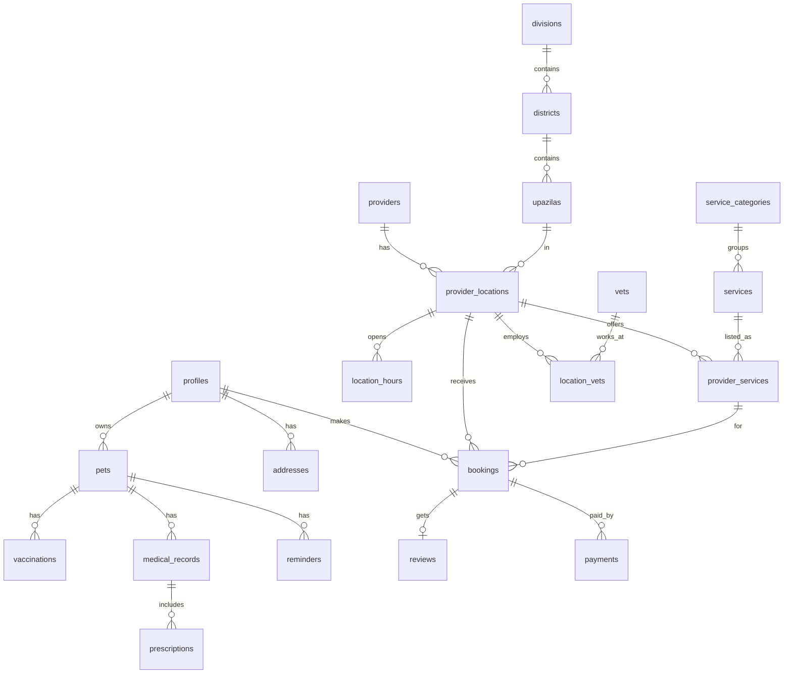

# Pranora — Backend Schema Document

Database: **Supabase PostgreSQL 15 + PostGIS**. Source of truth is `supabase/migrations/`; this document explains the design.
Related: [trd.md](./trd.md)

---

## 1. Conventions

- Table names: `snake_case`, plural. Primary keys: `id uuid default gen_random_uuid()`.
- Every table has `created_at timestamptz default now()`; mutable tables also have `updated_at` (trigger `set_updated_at`).
- Bilingual text: `name_bn`, `name_en` (at least one required). Clients pick by locale with fallback.
- Money: `numeric(10,2)` in BDT (৳).
- Time zone: store `timestamptz`; business hours as `time` interpreted in **Asia/Dhaka**.
- Soft delete where needed: `deleted_at timestamptz`.
- **RLS enabled on every table.**

---

## 2. Extensions

```sql
create extension if not exists postgis;
create extension if not exists pg_trgm;   -- fuzzy search (bn/en names)
create extension if not exists pg_cron;   -- reminders
```

---

## 3. Enums

```sql
create type user_role        as enum ('owner', 'vet', 'provider', 'admin');
create type app_locale       as enum ('bn', 'en');
create type species_type     as enum ('dog', 'cat', 'bird', 'rabbit', 'fish', 'cow', 'goat', 'poultry', 'other');
create type pet_gender       as enum ('male', 'female', 'unknown');
create type provider_type    as enum ('vet_clinic', 'pet_hospital', 'govt_vet_hospital', 'freelance_vet',
                                      'groomer', 'pet_shop', 'boarding', 'trainer', 'sitter', 'pet_taxi');
create type verification_status as enum ('draft', 'pending', 'verified', 'rejected', 'suspended');
create type booking_type     as enum ('slot', 'home_visit', 'online', 'date_range', 'order', 'instant', 'listing');
create type booking_status   as enum ('pending', 'confirmed', 'in_progress', 'completed',
                                      'cancelled_by_owner', 'cancelled_by_provider', 'no_show', 'expired');
create type payment_method   as enum ('cash', 'bkash', 'nagad', 'rocket', 'card');
create type payment_status   as enum ('pending', 'paid', 'failed', 'refunded');
create type reminder_type    as enum ('vaccine', 'deworming', 'flea_tick', 'medicine', 'grooming', 'checkup', 'custom');
create type order_status     as enum ('placed', 'confirmed', 'shipped', 'delivered', 'cancelled', 'returned');
```

---

## 4. Tables

### 4.1 Locations (Bangladesh admin areas)

```sql
create table divisions (
  id smallint primary key,
  name_bn text not null,
  name_en text not null
);

create table districts (
  id smallint primary key,
  division_id smallint not null references divisions(id),
  name_bn text not null,
  name_en text not null
);

create table upazilas (
  id integer primary key,
  district_id smallint not null references districts(id),
  name_bn text not null,
  name_en text not null,
  center geography(Point, 4326)
);
```
Seeded with 8 divisions, 64 districts and all upazilas/thanas.

### 4.2 Users

```sql
create table profiles (
  id uuid primary key references auth.users(id) on delete cascade,
  role user_role not null default 'owner',
  full_name text,
  phone text unique,                 -- +8801XXXXXXXXX
  email text,
  avatar_url text,
  locale app_locale not null default 'bn',
  district_id smallint references districts(id),
  push_token text,
  sms_opt_in boolean not null default true,
  created_at timestamptz not null default now(),
  updated_at timestamptz not null default now()
);

create table addresses (
  id uuid primary key default gen_random_uuid(),
  user_id uuid not null references profiles(id) on delete cascade,
  label text,                        -- বাসা / অফিস
  address_line text not null,
  upazila_id integer references upazilas(id),
  location geography(Point, 4326),
  is_default boolean not null default false,
  created_at timestamptz not null default now()
);
```

### 4.3 Pets

```sql
create table breeds (
  id serial primary key,
  species species_type not null,
  name_bn text,
  name_en text not null
);

create table pets (
  id uuid primary key default gen_random_uuid(),
  owner_id uuid not null references profiles(id) on delete cascade,
  name text not null,
  species species_type not null,
  breed_id integer references breeds(id),
  breed_other text,
  gender pet_gender not null default 'unknown',
  date_of_birth date,
  weight_kg numeric(5,2),
  color text,
  photo_url text,
  microchip_no text,
  is_neutered boolean,
  allergies text,
  public_qr_slug text unique,        -- for lost-pet QR ID card
  deleted_at timestamptz,
  created_at timestamptz not null default now(),
  updated_at timestamptz not null default now()
);

create table pet_weights (
  id uuid primary key default gen_random_uuid(),
  pet_id uuid not null references pets(id) on delete cascade,
  weight_kg numeric(5,2) not null,
  measured_on date not null default current_date
);
```

### 4.4 Providers, Clinics & Map Data

`providers` = any business (clinic, groomer, shop…). Each has one or more `provider_locations` (branches) that appear on the map.

```sql
create table providers (
  id uuid primary key default gen_random_uuid(),
  owner_user_id uuid not null references profiles(id),
  type provider_type not null,
  name_bn text,
  name_en text,
  description_bn text,
  description_en text,
  logo_url text,
  phone text not null,
  whatsapp text,
  email text,
  website text,
  trade_license_no text,
  is_government boolean not null default false,
  verification verification_status not null default 'draft',
  verified_at timestamptz,
  rating_avg numeric(2,1) not null default 0,
  rating_count integer not null default 0,
  created_at timestamptz not null default now(),
  updated_at timestamptz not null default now(),
  check (name_bn is not null or name_en is not null)
);

create table provider_locations (
  id uuid primary key default gen_random_uuid(),
  provider_id uuid not null references providers(id) on delete cascade,
  name_bn text,                      -- branch name, optional
  name_en text,
  address_bn text,
  address_en text,
  upazila_id integer references upazilas(id),
  location geography(Point, 4326) not null,
  phone text,
  is_24h boolean not null default false,
  has_emergency boolean not null default false,
  offers_home_visit boolean not null default false,
  home_visit_radius_km numeric(4,1),
  species_treated species_type[] not null default '{dog,cat}',
  photos text[] not null default '{}',
  is_active boolean not null default true,
  created_at timestamptz not null default now(),
  updated_at timestamptz not null default now()
);

create index provider_locations_location_gix on provider_locations using gist (location);
create index provider_locations_upazila_idx  on provider_locations (upazila_id);

create table location_hours (
  id uuid primary key default gen_random_uuid(),
  location_id uuid not null references provider_locations(id) on delete cascade,
  weekday smallint not null check (weekday between 0 and 6),  -- 0 = Sunday
  open_time time not null,
  close_time time not null,          -- if close < open, closes after midnight
  unique (location_id, weekday, open_time)
);

create table vets (
  id uuid primary key default gen_random_uuid(),
  user_id uuid unique references profiles(id),
  full_name_bn text,
  full_name_en text not null,
  bvc_reg_no text unique,            -- Bangladesh Veterinary Council registration
  degrees text,                      -- DVM, MS ...
  specialization text,
  experience_years smallint,
  photo_url text,
  consultation_fee numeric(10,2),
  online_consult boolean not null default false,
  verification verification_status not null default 'draft',
  created_at timestamptz not null default now()
);

create table location_vets (
  location_id uuid references provider_locations(id) on delete cascade,
  vet_id uuid references vets(id) on delete cascade,
  primary key (location_id, vet_id)
);

create table provider_documents (
  id uuid primary key default gen_random_uuid(),
  provider_id uuid references providers(id) on delete cascade,
  vet_id uuid references vets(id) on delete cascade,
  doc_type text not null,            -- bvc_certificate, trade_license, nid
  file_path text not null,           -- private bucket
  status verification_status not null default 'pending',
  reviewed_by uuid references profiles(id),
  review_note text,
  created_at timestamptz not null default now()
);

create table clinic_suggestions (
  id uuid primary key default gen_random_uuid(),
  suggested_by uuid references profiles(id),
  name text not null,
  phone text,
  address text,
  location geography(Point, 4326),
  status verification_status not null default 'pending',
  created_at timestamptz not null default now()
);
```

### 4.5 Services Catalog

```sql
create table service_categories (
  id smallserial primary key,
  slug text unique not null,         -- vet, vaccination, grooming, shop, boarding ...
  name_bn text not null,
  name_en text not null,
  icon text,
  sort_order smallint not null default 0
);

create table services (
  id serial primary key,
  category_id smallint not null references service_categories(id),
  slug text unique not null,         -- clinic_visit, home_visit, online_consult, rabies_vaccine, bath_groom ...
  name_bn text not null,
  name_en text not null,
  description_bn text,
  description_en text,
  booking_type booking_type not null,
  is_active boolean not null default true
);

create table provider_services (
  id uuid primary key default gen_random_uuid(),
  location_id uuid not null references provider_locations(id) on delete cascade,
  service_id integer not null references services(id),
  price numeric(10,2),
  price_max numeric(10,2),           -- for ranges
  duration_min smallint,
  species species_type[],
  is_active boolean not null default true,
  unique (location_id, service_id)
);
```

### 4.6 Scheduling & Bookings

```sql
create table availability_rules (
  id uuid primary key default gen_random_uuid(),
  location_id uuid not null references provider_locations(id) on delete cascade,
  vet_id uuid references vets(id),
  weekday smallint not null check (weekday between 0 and 6),
  start_time time not null,
  end_time time not null,
  slot_minutes smallint not null default 20,
  capacity smallint not null default 1
);

create table availability_exceptions (
  id uuid primary key default gen_random_uuid(),
  location_id uuid not null references provider_locations(id) on delete cascade,
  vet_id uuid references vets(id),
  date date not null,
  is_closed boolean not null default true,
  note text
);

create table bookings (
  id uuid primary key default gen_random_uuid(),
  code text unique not null,         -- PRN-24K7Q9 (shown to users)
  owner_id uuid not null references profiles(id),
  pet_id uuid references pets(id),
  location_id uuid not null references provider_locations(id),
  vet_id uuid references vets(id),
  provider_service_id uuid not null references provider_services(id),
  type booking_type not null,
  status booking_status not null default 'pending',
  starts_at timestamptz,
  ends_at timestamptz,
  address_id uuid references addresses(id),       -- home visit
  problem_note text,
  attachments text[] not null default '{}',
  price numeric(10,2),
  payment_method payment_method not null default 'cash',
  payment_status payment_status not null default 'pending',
  cancel_reason text,
  created_at timestamptz not null default now(),
  updated_at timestamptz not null default now()
);

create index bookings_owner_idx    on bookings (owner_id, starts_at desc);
create index bookings_location_idx on bookings (location_id, starts_at);
create unique index bookings_no_double_slot
  on bookings (vet_id, starts_at)
  where status in ('pending', 'confirmed') and vet_id is not null;
```

### 4.7 Health Records

```sql
create table vaccine_templates (
  id serial primary key,
  species species_type not null,
  name_bn text not null,
  name_en text not null,             -- Rabies, DHPP, FVRCP ...
  first_dose_age_weeks smallint not null,
  repeat_every_days integer,         -- null = once
  doses smallint not null default 1
);

create table vaccinations (
  id uuid primary key default gen_random_uuid(),
  pet_id uuid not null references pets(id) on delete cascade,
  template_id integer references vaccine_templates(id),
  name text not null,
  due_date date,
  given_date date,
  given_by_vet_id uuid references vets(id),
  batch_no text,
  booking_id uuid references bookings(id),
  certificate_path text,
  created_at timestamptz not null default now()
);

create table medical_records (
  id uuid primary key default gen_random_uuid(),
  pet_id uuid not null references pets(id) on delete cascade,
  booking_id uuid references bookings(id),
  vet_id uuid references vets(id),
  visit_date date not null default current_date,
  diagnosis text,
  notes text,
  attachments text[] not null default '{}',     -- private storage paths
  created_by uuid not null references profiles(id),
  created_at timestamptz not null default now()
);

create table prescriptions (
  id uuid primary key default gen_random_uuid(),
  medical_record_id uuid not null references medical_records(id) on delete cascade,
  medicine text not null,
  dosage text,
  frequency text,
  duration_days smallint,
  instructions text
);

create table reminders (
  id uuid primary key default gen_random_uuid(),
  pet_id uuid not null references pets(id) on delete cascade,
  owner_id uuid not null references profiles(id) on delete cascade,
  type reminder_type not null,
  title text not null,
  remind_at timestamptz not null,
  repeat_days integer,
  vaccination_id uuid references vaccinations(id) on delete cascade,
  is_done boolean not null default false,
  last_sent_at timestamptz,
  created_at timestamptz not null default now()
);

create index reminders_due_idx on reminders (remind_at) where is_done = false;
```

### 4.8 Shop & Orders (Phase 2)

```sql
create table products (
  id uuid primary key default gen_random_uuid(),
  provider_id uuid not null references providers(id) on delete cascade,
  name_bn text, name_en text,
  description_bn text, description_en text,
  category text not null,            -- food, medicine, accessories, toys
  species species_type[],
  price numeric(10,2) not null,
  sale_price numeric(10,2),
  stock integer not null default 0,
  images text[] not null default '{}',
  requires_prescription boolean not null default false,
  is_active boolean not null default true,
  created_at timestamptz not null default now()
);

create table orders (
  id uuid primary key default gen_random_uuid(),
  code text unique not null,
  owner_id uuid not null references profiles(id),
  provider_id uuid not null references providers(id),
  address_id uuid not null references addresses(id),
  status order_status not null default 'placed',
  subtotal numeric(10,2) not null,
  delivery_fee numeric(10,2) not null default 0,
  total numeric(10,2) not null,
  payment_method payment_method not null default 'cash',
  payment_status payment_status not null default 'pending',
  created_at timestamptz not null default now()
);

create table order_items (
  id uuid primary key default gen_random_uuid(),
  order_id uuid not null references orders(id) on delete cascade,
  product_id uuid not null references products(id),
  quantity integer not null check (quantity > 0),
  unit_price numeric(10,2) not null
);
```

### 4.9 Payments

```sql
create table payments (
  id uuid primary key default gen_random_uuid(),
  booking_id uuid references bookings(id),
  order_id uuid references orders(id),
  user_id uuid not null references profiles(id),
  amount numeric(10,2) not null,
  method payment_method not null,
  status payment_status not null default 'pending',
  gateway text,                      -- sslcommerz, bkash
  gateway_tran_id text unique,
  gateway_val_id text,
  raw_response jsonb,
  created_at timestamptz not null default now(),
  check (booking_id is not null or order_id is not null)
);
```

### 4.10 Reviews, Community, Adoption, Lost & Found

```sql
create table reviews (
  id uuid primary key default gen_random_uuid(),
  booking_id uuid unique not null references bookings(id),
  author_id uuid not null references profiles(id),
  provider_id uuid not null references providers(id),
  vet_id uuid references vets(id),
  rating smallint not null check (rating between 1 and 5),
  comment text,
  is_hidden boolean not null default false,
  created_at timestamptz not null default now()
);

create table adoption_listings (
  id uuid primary key default gen_random_uuid(),
  posted_by uuid not null references profiles(id),
  pet_name text,
  species species_type not null,
  breed text,
  age_months smallint,
  gender pet_gender,
  description text,
  photos text[] not null default '{}',
  upazila_id integer references upazilas(id),
  location geography(Point, 4326),
  is_vaccinated boolean,
  status text not null default 'available',   -- available, reserved, adopted
  created_at timestamptz not null default now()
);

create table lost_found_posts (
  id uuid primary key default gen_random_uuid(),
  posted_by uuid not null references profiles(id),
  kind text not null check (kind in ('lost', 'found')),
  pet_id uuid references pets(id),
  species species_type not null,
  description text,
  photos text[] not null default '{}',
  last_seen_at timestamptz,
  location geography(Point, 4326) not null,
  contact_phone text,
  is_resolved boolean not null default false,
  created_at timestamptz not null default now()
);

create index lost_found_location_gix on lost_found_posts using gist (location);

create table articles (
  id uuid primary key default gen_random_uuid(),
  slug text unique not null,
  title_bn text, title_en text,
  body_bn text, body_en text,
  cover_url text,
  species species_type[],
  published_at timestamptz,
  author_id uuid references profiles(id)
);
```

### 4.11 Notifications & Config

```sql
create table notifications (
  id uuid primary key default gen_random_uuid(),
  user_id uuid not null references profiles(id) on delete cascade,
  title_bn text, title_en text,
  body_bn text, body_en text,
  data jsonb,                        -- deep link: { "screen": "booking", "id": "..." }
  channel text not null default 'push',
  read_at timestamptz,
  created_at timestamptz not null default now()
);

create table app_config (
  key text primary key,              -- emergency_hotlines, min_app_version ...
  value jsonb not null
);
```

---

## 5. Functions & RPC

### 5.1 Is a location open now?

```sql
create or replace function is_location_open(p_location_id uuid, p_at timestamptz default now())
returns boolean
language sql stable as $$
  with t as (
    select (p_at at time zone 'Asia/Dhaka') as local_ts
  )
  select exists (
    select 1
    from provider_locations pl, t
    where pl.id = p_location_id and pl.is_24h
  ) or exists (
    select 1
    from location_hours h, t
    where h.location_id = p_location_id
      and (
        -- same-day window
        (h.close_time > h.open_time
          and h.weekday = extract(dow from t.local_ts)
          and t.local_ts::time >= h.open_time
          and t.local_ts::time <  h.close_time)
        -- window that passes midnight: evening part
        or (h.close_time <= h.open_time
          and h.weekday = extract(dow from t.local_ts)
          and t.local_ts::time >= h.open_time)
        -- window that passes midnight: after-midnight part (started yesterday)
        or (h.close_time <= h.open_time
          and h.weekday = (extract(dow from t.local_ts)::int + 6) % 7
          and t.local_ts::time < h.close_time)
      )
  );
$$;
```

### 5.2 ⭐ Nearest clinics

```sql
create or replace function nearby_clinics(
  p_lat double precision,
  p_lng double precision,
  p_radius_m integer default 5000,
  p_open_now boolean default false,
  p_emergency boolean default false,
  p_home_visit boolean default false,
  p_species species_type default null,
  p_service text default null,       -- services.slug
  p_types provider_type[] default array['vet_clinic','pet_hospital','govt_vet_hospital','freelance_vet']::provider_type[],
  p_limit integer default 50
)
returns table (
  location_id uuid,
  provider_id uuid,
  name_bn text,
  name_en text,
  address_bn text,
  address_en text,
  phone text,
  type provider_type,
  is_government boolean,
  is_24h boolean,
  has_emergency boolean,
  offers_home_visit boolean,
  is_open_now boolean,
  rating_avg numeric,
  rating_count integer,
  lat double precision,
  lng double precision,
  distance_m double precision
)
language sql stable as $$
  with origin as (
    select st_setsrid(st_makepoint(p_lng, p_lat), 4326)::geography as g
  )
  select
    pl.id,
    p.id,
    coalesce(pl.name_bn, p.name_bn),
    coalesce(pl.name_en, p.name_en),
    pl.address_bn,
    pl.address_en,
    coalesce(pl.phone, p.phone),
    p.type,
    p.is_government,
    pl.is_24h,
    pl.has_emergency,
    pl.offers_home_visit,
    is_location_open(pl.id) as is_open_now,
    p.rating_avg,
    p.rating_count,
    st_y(pl.location::geometry),
    st_x(pl.location::geometry),
    st_distance(pl.location, o.g) as distance_m
  from provider_locations pl
  join providers p on p.id = pl.provider_id
  cross join origin o
  where pl.is_active
    and p.verification = 'verified'
    and p.type = any (p_types)
    and st_dwithin(pl.location, o.g, p_radius_m)
    and (not p_emergency  or pl.has_emergency or pl.is_24h)
    and (not p_home_visit or pl.offers_home_visit)
    and (p_species is null or p_species = any (pl.species_treated))
    and (not p_open_now   or is_location_open(pl.id))
    and (p_service is null or exists (
          select 1 from provider_services ps
          join services s on s.id = ps.service_id
          where ps.location_id = pl.id and ps.is_active and s.slug = p_service))
  order by pl.location <-> o.g
  limit p_limit;
$$;

grant execute on function nearby_clinics to anon, authenticated;
```

Pass a different `p_types` array to reuse it for groomers, pet shops and boarding (map layers).

### 5.3 Other RPCs

| Function | Purpose |
|---|---|
| `available_slots(location_id, vet_id, date)` | Generates free slots from `availability_rules` minus exceptions and existing bookings |
| `create_booking(...)` | Validates slot, inserts booking with generated `code`, raises if double-booked |
| `generate_vaccine_schedule(pet_id)` | Trigger after pet insert — creates `vaccinations` + `reminders` from templates |
| `refresh_provider_rating(provider_id)` | Trigger after review insert/update |
| `is_admin()` | `select role = 'admin' from profiles where id = auth.uid()` |

---

## 6. Row Level Security (summary)

| Table | Select | Insert / Update / Delete |
|---|---|---|
| `profiles` | Own row; admins all | Own row (role change admin-only) |
| `pets`, `pet_weights`, `vaccinations`, `reminders` | Owner; vet with a booking for that pet | Owner; vet can add vaccinations for booked pets |
| `medical_records`, `prescriptions` | Owner of pet; vet who created; admins | Vet with a booking for that pet; owner can upload own records |
| `providers`, `provider_locations`, `location_hours`, `provider_services`, `vets` | Public if `verified`; owner always | Owner of provider; admins |
| `provider_documents` | Owner; admins | Owner insert; admins update status |
| `bookings` | Owner; staff of that provider; admins | Owner creates (via `create_booking`); provider updates status |
| `payments` | Owner; admins | Edge Functions only (service role) |
| `reviews` | Public (not hidden) | Author of a completed booking |
| `adoption_listings`, `lost_found_posts`, `articles` | Public | Author; admins |
| `notifications` | Own | Service role only |
| `divisions`, `districts`, `upazilas`, `services`, `service_categories`, `breeds`, `vaccine_templates`, `app_config` | Public | Admins |

---

## 7. Storage Buckets

| Bucket | Access | Contents |
|---|---|---|
| `avatars` | Public | User & pet photos |
| `provider-media` | Public | Clinic photos, logos, product images |
| `medical` | Private (signed URLs) | Reports, prescriptions, certificates |
| `documents` | Private (admin + owner) | BVC certificates, trade licenses, NID |

---

## 8. ER Diagram (core)


