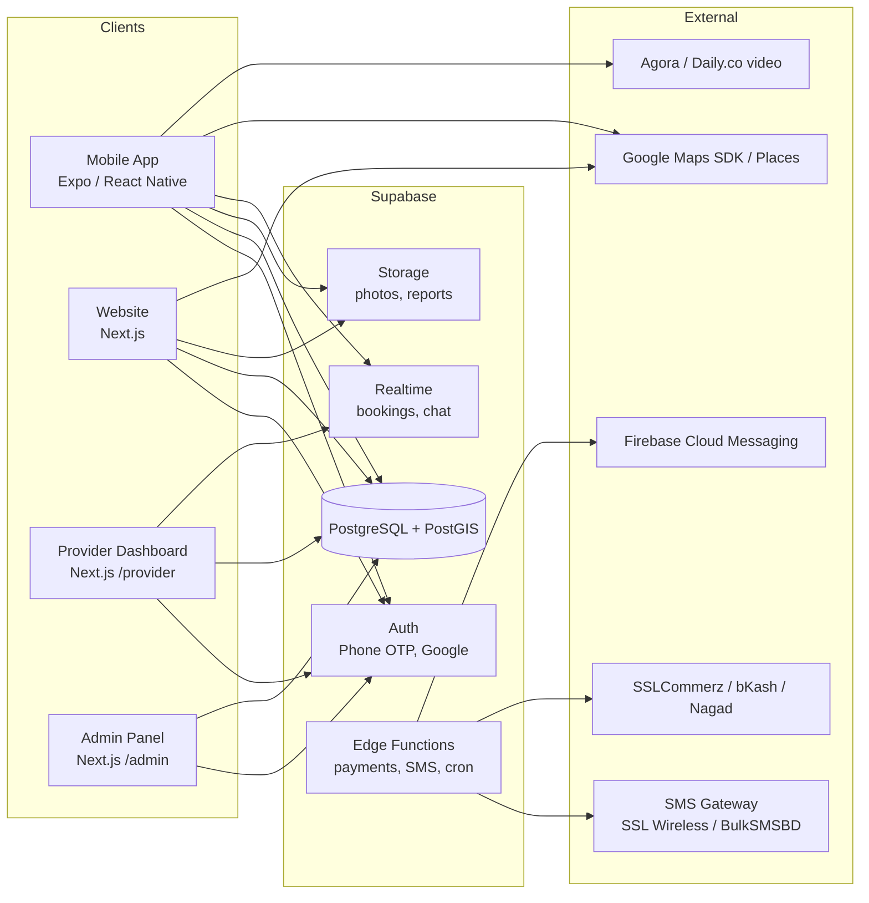

# Pranora — Technical Requirements Document (TRD)

Version 1.0 · Related: [prd.md](./prd.md) · [schema.md](./schema.md) · [app-flow.md](./app-flow.md)

---

## 1. Architecture Overview



One shared TypeScript codebase (monorepo) for app and web, with Supabase as the backend.

---

## 2. Tech Stack

| Layer | Technology | Why |
|---|---|---|
| Monorepo | **Turborepo** + **pnpm workspaces** | Shared types, i18n, API client between app and web |
| Mobile app | **Expo (React Native) SDK latest**, Expo Router, TypeScript | One codebase for Android + iOS, OTA updates |
| Website | **Next.js (App Router)**, TypeScript, Server Components | SEO for Bangla search queries, fast pages |
| Styling | **Tailwind CSS** (web), **NativeWind** (app) | Same design tokens on both |
| UI kit (web) | shadcn/ui (Radix) | Accessible components |
| State / data | **TanStack Query** + Zustand (light client state) | Caching, offline-friendly |
| Forms | React Hook Form + **Zod** | Shared validation schemas |
| i18n | **i18next** + react-i18next (app), **next-intl** (web) | Bangla default, English fallback |
| Maps (app) | **react-native-maps** (Google provider) | Native performance, clustering |
| Maps (web) | **@vis.gl/react-google-maps** | Official Google Maps for React |
| Geocoding | Google Places Autocomplete; optional **Barikoi** for BD addresses | Better Bangladeshi address coverage |
| Backend | **Supabase** — Postgres 15 + **PostGIS**, Auth, Storage, Realtime, Edge Functions (Deno) | Fast to build, RLS security, geo queries |
| Payments | **SSLCommerz** (cards, bKash, Nagad, Rocket); direct bKash Tokenized API later | Most used BD gateways |
| SMS | SSL Wireless / BulkSMSBD via Edge Function | Local delivery, Bangla Unicode SMS |
| Push | Expo Notifications → FCM / APNs | |
| Video consult | Agora or Daily.co (Phase 2) | Works on low bandwidth |
| Analytics | PostHog | Product analytics, funnels |
| Errors | Sentry (app + web) | |
| Hosting | Vercel (web), Supabase Cloud (Singapore region — closest to BD), EAS Build (app) | |
| CI/CD | GitHub Actions | Lint, typecheck, test, preview deploys |

---

## 3. Repository Structure

```
pranora/
├── apps/
│   ├── mobile/                # Expo app (pet owner + provider mode)
│   │   ├── app/               # Expo Router screens
│   │   ├── components/
│   │   └── features/          # map, pets, booking, health, services ...
│   └── web/                   # Next.js — public site, /provider, /admin
│       ├── app/[locale]/      # bn (default) | en
│       └── components/
├── packages/
│   ├── ui/                    # shared design tokens, icons
│   ├── i18n/                  # bn.json, en.json, formatters (৳, dates, digits)
│   ├── api/                   # typed Supabase client, query hooks
│   ├── types/                 # generated DB types (supabase gen types)
│   └── validation/            # Zod schemas
├── supabase/
│   ├── migrations/            # SQL migrations (source of truth for schema)
│   ├── functions/             # Edge Functions
│   └── seed.sql               # divisions, districts, upazilas, species, services
├── docs/                      # PRD, TRD, flows, design, schema, tracker
└── .github/workflows/
```

---

## 4. Nearest Veterinary Feature — Technical Design

### 4.1 Data
- `clinics.location` is a `geography(Point, 4326)` column with a **GiST index**.
- Opening hours stored in `clinic_hours` (weekday, open_time, close_time, is_24h); timezone **Asia/Dhaka**.

### 4.2 Query (RPC)
Clients call the Postgres function `nearby_clinics` through `supabase.rpc()`:

```sql
select * from nearby_clinics(
  p_lat        => 23.7465,
  p_lng        => 90.3760,
  p_radius_m   => 5000,
  p_open_now   => true,
  p_emergency  => false,
  p_species    => 'dog',
  p_service    => 'home_visit',
  p_limit      => 50
);
```

Returns: clinic id, bilingual name, address, phone, `distance_m`, `is_open_now`, rating, lat/lng, service slugs. Full SQL in [schema.md §5](./schema.md#5-functions--rpc).

### 4.3 Client behavior
1. Ask for location permission (with Bangla rationale screen). Use `expo-location` (app) or `navigator.geolocation` (web).
2. If denied/unavailable → area search (Places Autocomplete restricted to `country: bd`) or division → district → upazila picker.
3. Call `nearby_clinics` with default radius **5 km**; if fewer than 3 results, retry with 15 km then 50 km.
4. Render markers (clustered) + bottom sheet list sorted by distance.
5. Map viewport change → debounced (500 ms) re-query using the map center.
6. Cache last result (TanStack Query persist + AsyncStorage) for offline fallback.
7. **Directions** opens `https://www.google.com/maps/dir/?api=1&destination=lat,lng`; **Call** opens `tel:`.

### 4.4 Emergency mode
Same RPC with `p_open_now => true, p_emergency => true`, radius starting at 10 km, results sorted by distance, call button first. Also shows the national helpline and DLS hotline numbers from `app_config`.

### 4.5 Performance targets
- RPC p95 < 300 ms for 50 results (GiST index + `ST_DWithin`).
- Map first render < 1.5 s on 4G.
- Map API cost control: no Places calls during panning; only on explicit search.

---

## 5. Services Catalog — Technical Design

- `service_categories` (vet, grooming, shop, boarding, …) and `services` (bilingual name, description, icon, `booking_type`).
- `booking_type` decides the flow: `slot` (appointments), `home_visit`, `order` (shop), `date_range` (boarding), `instant` (emergency/online consult), `listing` (adoption, lost & found).
- Providers link to services through `provider_services` with their own price and duration.
- The same catalog drives the app's Services tab, the website `/services` pages and map layer filters.

---

## 6. Authentication & Authorization

- **Phone OTP** (Supabase Auth with custom SMS hook → local SMS gateway). BD number format `+8801XXXXXXXXX` validated with Zod.
- Google sign-in (Phase 1.5).
- Roles in `profiles.role`: `owner`, `vet`, `provider`, `admin`.
- **Row Level Security on every table**. Owners see only their pets/records; providers see only bookings assigned to them; admins via `is_admin()` helper.
- Service-role key used **only** inside Edge Functions, never shipped to clients.

---

## 7. Internationalization

- Locales: `bn` (default), `en`. Web routes: `/` (bn) and `/en/...`.
- Translation files in `packages/i18n/locales/{bn,en}/*.json`, namespaced by feature.
- Formatters: `formatCurrency` (`৳ ১,২০০`), `formatDistance` (`২.৩ কি.মি.` / `2.3 km`), `formatDate` using `Intl` with `bn-BD` / `en-BD`.
- Bangla font: **Hind Siliguri** (UI) and **Noto Sans Bengali** (fallback); English: **Inter**.
- DB content bilingual columns `*_bn`, `*_en`; helper `pickLocale(row, 'name', locale)`.

---

## 8. Notifications & Scheduled Jobs

| Job | Schedule | Implementation |
|---|---|---|
| Vaccine / deworming reminders | Daily 9:00 AM Dhaka | `pg_cron` → Edge Function `send-reminders` |
| Booking reminders | Every 15 min | `pg_cron` → `send-booking-reminders` |
| Clinic "open now" | Computed in query | No job needed |
| Expire pending bookings | Every 30 min | SQL function |

Channels: push (Expo), SMS (critical only, to control cost), in-app `notifications` table (Realtime).

---

## 9. Payments

1. Client creates booking/order with `payment_status = 'pending'`.
2. Edge Function `payments-init` creates an SSLCommerz session → returns gateway URL.
3. App opens it in an in-app browser; web redirects.
4. SSLCommerz calls `payments-ipn` webhook → validate with SSLCommerz validation API → update `payments` and booking/order.
5. Never trust client-side success redirects.

---

## 10. API Surface

Most reads/writes go through the Supabase client with RLS. Logic that must be trusted runs in Edge Functions:

| Function | Purpose |
|---|---|
| `nearby_clinics` (SQL RPC) | Nearest vet search |
| `search_providers` (SQL RPC) | Text + geo search across providers |
| `create_booking` (SQL RPC) | Slot locking, prevents double booking |
| `payments-init`, `payments-ipn` | Payment flow |
| `send-sms`, `send-reminders` | Notifications |
| `verify-provider` | Admin approval workflow |
| `generate-health-pdf` | Bilingual health record export |

---

## 11. Security & Privacy

- RLS on all tables; tests for policies.
- OTP: max 5 requests per phone per hour; captcha (Cloudflare Turnstile) on web.
- File uploads: images ≤ 5 MB, PDFs ≤ 10 MB, MIME validated; private buckets for medical files with signed URLs.
- User location is never stored precisely unless the user saves an address.
- Secrets in Supabase/Vercel/EAS secrets; `.env` never committed.
- Comply with Bangladesh Digital Security / data protection guidelines; privacy policy in Bangla and English.

---

## 12. Testing

| Type | Tool |
|---|---|
| Unit | Vitest (packages, web), Jest (mobile) |
| Component | React Testing Library / RN Testing Library |
| E2E web | Playwright |
| E2E app | Maestro |
| DB / RLS | pgTAP via `supabase test db` |

CI must pass lint, typecheck, unit tests and migration checks before merge.

---

## 13. Environments

| Env | Web | Backend | App |
|---|---|---|---|
| Local | `pnpm dev` | `supabase start` (Docker) | Expo Go / dev client |
| Staging | Vercel preview | Supabase staging project | EAS internal channel |
| Production | pranora.com.bd | Supabase prod (Singapore) | Play Store / App Store |

### Environment variables
```
NEXT_PUBLIC_SUPABASE_URL=
NEXT_PUBLIC_SUPABASE_ANON_KEY=
EXPO_PUBLIC_SUPABASE_URL=
EXPO_PUBLIC_SUPABASE_ANON_KEY=
NEXT_PUBLIC_GOOGLE_MAPS_API_KEY=
EXPO_PUBLIC_GOOGLE_MAPS_API_KEY=
SUPABASE_SERVICE_ROLE_KEY=        # Edge Functions only
SSLCOMMERZ_STORE_ID=
SSLCOMMERZ_STORE_PASSWORD=
SMS_API_KEY=
SENTRY_DSN=
```
