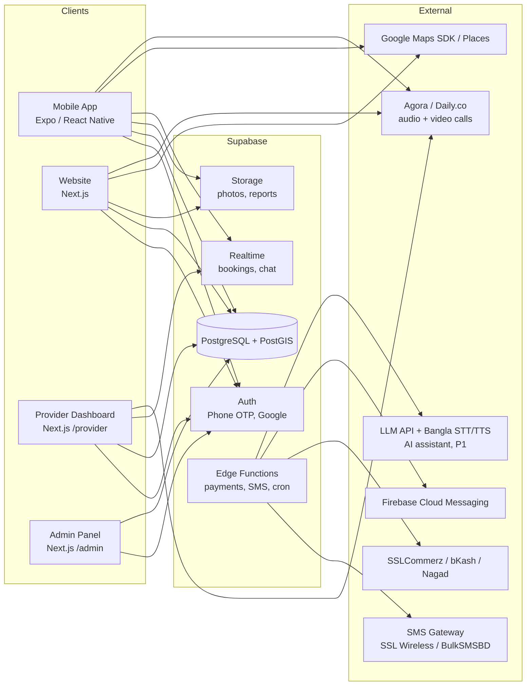

# Pranora — Technical Requirements Document (TRD)

Version 1.0 · Related: [prd.md](./prd.md) · [schema.md](./schema.md) · [app-flow.md](./app-flow.md)

---

## 1. Architecture Overview



One shared TypeScript codebase (monorepo) for app and web, with Supabase as the backend.

---

## 2. Tech Stack

| Layer | Technology | Why |
|---|---|---|
| Monorepo | **Turborepo** + **pnpm workspaces** | Shared types, i18n, API client between app and web |
| Mobile app | **Expo (React Native) SDK latest**, Expo Router, TypeScript | One codebase for Android + iOS, OTA updates |
| Website | **Next.js (App Router)**, TypeScript, Server Components | SEO for Bangla search queries, fast pages |
| Styling | **Tailwind CSS** (web), **NativeWind** (app) | Same design tokens on both |
| UI kit (web) | shadcn/ui (Radix) | Accessible components |
| State / data | **TanStack Query** + Zustand (light client state) | Caching, offline-friendly |
| Forms | React Hook Form + **Zod** | Shared validation schemas |
| i18n | **i18next** + react-i18next (app), **next-intl** (web) | Bangla default, English fallback |
| Maps (app) | **react-native-maps** (Google provider) | Native performance, clustering |
| Maps (web) | **@vis.gl/react-google-maps** | Official Google Maps for React |
| Geocoding | Google Places Autocomplete; optional **Barikoi** for BD addresses | Better Bangladeshi address coverage |
| Backend | **Supabase** — Postgres 15 + **PostGIS**, Auth, Storage, Realtime, Edge Functions (Deno) | Fast to build, RLS security, geo queries |
| Payments | **SSLCommerz** (cards, bKash, Nagad, Rocket); direct bKash Tokenized API later | Most used BD gateways |
| SMS | SSL Wireless / BulkSMSBD via Edge Function | Local delivery, Bangla Unicode SMS |
| Push | Expo Notifications → FCM / APNs | |
| Audio/video calls | Agora or Daily.co (Phase 2) | Works on low bandwidth; recording off by default |
| AI assistant | LLM API (vendor TBD, must handle Bangla well) + Bangla speech-to-text / text-to-speech for voice (Phase 2) | Called only from an Edge Function with guardrails |
| Analytics | PostHog | Product analytics, funnels |
| Errors | Sentry (app + web) | |
| Hosting | Vercel (web), Supabase Cloud (Singapore region — closest to BD), EAS Build (app) | |
| CI/CD | GitHub Actions | Lint, typecheck, test, preview deploys |

---

## 3. Repository Structure

```
pranora/
├── apps/
│   ├── mobile/                # Expo app (pet owner + provider mode)
│   │   ├── app/               # Expo Router screens
│   │   ├── components/
│   │   └── features/          # map, pets, booking, health, services, rescue, adoption, ai, calls ...
│   └── web/                   # Next.js — public site, /provider, /admin
│       ├── app/[locale]/      # bn (default) | en
│       └── components/
├── packages/
│   ├── ui/                    # shared design tokens, icons
│   ├── i18n/                  # bn.json, en.json, formatters (৳, dates, digits)
│   ├── api/                   # typed Supabase client, query hooks
│   ├── types/                 # generated DB types (supabase gen types)
│   └── validation/            # Zod schemas
├── supabase/
│   ├── migrations/            # SQL migrations (source of truth for schema)
│   ├── functions/             # Edge Functions
│   └── seed.sql               # divisions, districts, upazilas, species, services
├── docs/                      # PRD, TRD, flows, design, schema, tracker
└── .github/workflows/
```

---

## 4. Nearest Veterinary Feature — Technical Design

### 4.1 Data
- `provider_locations.location` is a `geography(Point, 4326)` column with a **GiST index**.
- Opening hours stored in `location_hours` (weekday, open_time, close_time) plus `provider_locations.is_24h`; timezone **Asia/Dhaka**.

### 4.2 Query (RPC)
Clients call the Postgres function `nearby_clinics` through `supabase.rpc()`:

```sql
select * from nearby_clinics(
  p_lat        => 23.7465,
  p_lng        => 90.3760,
  p_radius_m   => 5000,
  p_open_now   => true,
  p_emergency  => false,
  p_species    => 'dog',
  p_service    => 'home_visit',
  p_max_fee    => 800,
  p_limit      => 50
);
```

Returns: location id, bilingual name, address, phone, `distance_m`, `is_open_now`, rating, `fee_from`, lat/lng. Full SQL in [schema.md §5](./schema.md#5-functions--rpc).

### 4.3 Client behavior
1. Ask for location permission (with Bangla rationale screen). Use `expo-location` (app) or `navigator.geolocation` (web).
2. If denied/unavailable → area search (Places Autocomplete restricted to `country: bd`) or division → district → upazila picker.
3. Call `nearby_clinics` with default radius **5 km**; if fewer than 3 results, retry with 15 km then 50 km.
4. Render markers (clustered) + bottom sheet list sorted by distance.
5. Map viewport change → debounced (500 ms) re-query using the map center.
6. Cache last result (TanStack Query persist + AsyncStorage) for offline fallback.
7. **Directions** opens `https://www.google.com/maps/dir/?api=1&destination=lat,lng`; **Call** opens `tel:`.

### 4.4 Emergency mode
Same RPC with `p_open_now => true, p_emergency => true`, radius starting at 10 km, results sorted by distance, call button first. Also shows the national helpline and DLS hotline numbers from `app_config`.

### 4.5 Performance targets
- RPC p95 < 300 ms for 50 results (GiST index + `ST_DWithin`).
- Map first render < 1.5 s on 4G.
- Map API cost control: no Places calls during panning; only on explicit search.

---

## 5. Services Catalog — Technical Design

- `service_categories` (vet, grooming, shop, boarding, …) and `services` (bilingual name, description, icon, `booking_type`).
- `booking_type` decides the flow: `slot` (appointments by time), `serial` (appointments by serial number), `home_visit`, `order` (shop), `date_range` (boarding), `instant` (emergency/online consult), `listing` (adoption — opens its own flow, see §6). Rescue, including lost & found, is not a bookable service; its catalog tile opens the rescue report flow.
- Providers link to services through `provider_services` with their own price and duration.
- The same catalog drives the app's Services tab, the website `/services` pages and map layer filters.

### 5.1 Vet schedule: slots or serial numbers
- Each `availability_rules` row has `mode`: `slot` (fixed-length time slots with capacity) or `serial` (a session, e.g. 5–9 PM, with serial numbers 1..`max_serials`) — the common Bangladeshi "সিরিয়াল" system.
- Holidays / days off are `availability_exceptions`.
- `create_booking` locks the rule row (`select … for update`), then picks the slot or the next free serial; partial unique indexes on `bookings` make double booking impossible even under races.
- Cancel/reschedule is allowed until `provider_locations.cancel_cutoff_hours` before the start; after that only the provider can change it.

---

## 6. Rescue & Adoption — Technical Design

### 6.1 Rescue flow
1. Any logged-in user inserts `animal_reports` with kind `injured`, `lost`, `found` or `abandoned` (lost & found is part of rescue; an owner reporting their own lost pet links `pet_id` and `last_seen_at`) (photo upload to private `rescue-media`, EXIF stripped by the `media-process` Edge Function, location from GPS or a map pin).
2. Insert trigger: if `urgency in ('high','critical')`, call Edge Function `rescue-alert` → push + SMS to on-duty reviewers (verified shelters in that district, else admins) immediately. If still `submitted` after `app_config.rescue_escalation_minutes` (default 15), a `pg_cron` job escalates to all admins.
3. Review queue = `animal_reports` ordered by `urgency desc, created_at`. `review_animal_report` creates a `rescue_cases` row.
4. `assign_rescuer` offers the case to one rescuer (partial unique index = one active assignment); `respond_to_assignment` accepts or declines (decline → back to the queue).
5. Rescuer/shelter add `rescue_case_updates` (notes, photos, status). A vet treating the animal writes `medical_records` with `rescue_case_id`.
6. `close_rescue_case` requires an `outcome`; if the animal stays in care it gets a `pets` profile (custodian = rescuer or shelter), which can later be listed for adoption.
7. The reporter only calls `my_report_status` — no notes, no rescuer identity, no other data.
8. P1: duplicate detection suggests reports within 300 m, same species, within 48 h → reviewer merges (also matches a `found` report to an open `lost` one); `nearby_rescuers` uses `ST_DWithin` on `rescuer_profiles`.
9. P1 (RSC-10): public lost & found board reads the `lost_found_board` view (no phone, no reporter, location snapped to ~1 km). "আমি দেখেছি / I've seen it" sends an in-app notification to the reporter, who decides whether to share their number. New lost/found reports push an alert to users whose saved address is within 3 km.

### 6.2 Adoption flow
1. Listings are created from a `pets` row by a verified `shelter` or `adoption_lister`; public pages (`/adoption`, SEO) read them with the anon key — district/upazila only, never an exact point.
2. Applications are a single Zod-validated form; status changes only through `decide_adoption_application`, which checks the caller is a human reviewer (the AI Edge Function has no grant to call it).
3. Approving one application sets the listing `reserved` and creates `adoption_handovers`. Both sides call `confirm_handover`; when both timestamps exist, `complete_adoption_handover()` runs in one transaction: transfers `pets.owner_id`, writes `pet_ownership_history`, sets the listing `adopted`, rejects the remaining applications with a polite notice. The unique `listing_id` on handovers guarantees one handover per listing.
4. Medical and vaccine records are keyed by `pet_id`, so they automatically follow the animal to the new owner.
5. P1: favorites, `content_reports` for fake listings, `adoption_followups` sent by `pg_cron` at 7 and 30 days.

---

## 7. Authentication & Authorization

- **Phone OTP** (Supabase Auth with custom SMS hook → local SMS gateway) **or email** (email OTP / magic link, password optional) — both P0. BD number format `+8801XXXXXXXXX` validated with Zod.
- Google sign-in (P1).
- Roles live in `user_roles` (many per user): `owner`, `rescuer`, `shelter`, `adoption_lister`, `vet`, `provider`, `admin`. `owner` is granted on sign-up; the others start `pending` and need admin verification. The app shows a role switcher when a user has more than one role.
- **Row Level Security on every table**. Owners see only their pets/records; providers see only bookings assigned to them; rescuers see only their assigned cases; helpers `has_role()` and `is_admin()`.
- Service-role key used **only** inside Edge Functions, never shipped to clients.

---

## 8. Internationalization

- Locales: `bn` (default), `en`. Web routes: `/` (bn) and `/en/...`.
- Translation files in `packages/i18n/locales/{bn,en}/*.json`, namespaced by feature.
- Formatters: `formatCurrency` (`৳ ১,২০০`), `formatDistance` (`২.৩ কি.মি.` / `2.3 km`), `formatDate` using `Intl` with `bn-BD` / `en-BD`.
- Bangla font: **Hind Siliguri** (UI) and **Noto Sans Bengali** (fallback); English: **Inter**.
- DB content bilingual columns `*_bn`, `*_en`; helper `pickLocale(row, 'name', locale)`.

---

## 9. Notifications & Scheduled Jobs

| Job | Schedule | Implementation |
|---|---|---|
| Vaccine / deworming reminders (P1) | Daily 9:00 AM Dhaka | `pg_cron` → Edge Function `send-reminders` (push + in-app + SMS) |
| Booking reminders (P1) | Every 15 min | `pg_cron` → `send-booking-reminders` (push + in-app + SMS) |
| Urgent rescue report alert | On insert | Trigger → `rescue-alert` (push + SMS) |
| Rescue escalation | Every 5 min | `pg_cron`: urgent reports still `submitted` after 15 min → all admins |
| Adoption follow-up | Daily | `pg_cron` → `send-followups` (7 and 30 days after handover, P1) |
| AI message retention | Daily | Delete `ai_messages` older than 90 days |
| Clinic "open now" | Computed in query | No job needed |
| Expire pending bookings | Every 30 min | SQL function |

Channels: in-app `notifications` table (Realtime), push (Expo) and SMS — all available from P0. In the MVP, SMS is used only for OTP and critical alerts (urgent rescue, booking confirmed); reminders (push and SMS) start in P1 (build-order module 5).

---

## 10. Payments

The MVP is cash only (PAY-1, cash at clinic). Online payment — bKash, Nagad, Rocket and cards via SSLCommerz — starts in **P1** (team decision; the source PDF lists it as future), together with invoices/refunds and provider payouts. The pet shop (P1) supports cash on delivery and online payment at checkout:

1. Client creates booking/order with `payment_status = 'pending'`.
2. Edge Function `payments-init` creates an SSLCommerz session → returns gateway URL.
3. App opens it in an in-app browser; web redirects.
4. SSLCommerz calls `payments-ipn` webhook → validate with SSLCommerz validation API → update `payments` and booking/order.
5. Never trust client-side success redirects.
6. Refunds go through the SSLCommerz refund API from Edge Function `payments-refund` (admin- or policy-triggered); invoices are generated as bilingual PDFs; provider payouts are calculated weekly from paid, completed bookings and paid out manually by the team at first (bKash/bank), recorded in the admin panel.

---

## 11. AI Assistant & Calls (P1)

### 11.1 AI assistant (chat & voice)
- Clients never call the LLM directly. Edge Function `ai-chat` receives the message, adds a system prompt and (only if `share_pet_context`) the pet's species and age — never phone numbers, addresses or owner names.
- Guardrails (system prompt + server-side checks, tested with a fixed bn/en eval set before release):
  - No diagnosis, no medicine names or doses, no prescriptions — answers general care only.
  - Emergency-sign classifier (breathing trouble, seizures, bleeding, poisoning, trauma …) runs before the LLM; if triggered it returns a fixed bilingual "এখনই ভেটের কাছে যান" message + emergency map link, and sets `emergency_flag`.
  - Always identifies itself as AI; never claims to be human.
  - Never asks for passwords, OTPs or payment details; such input is masked before storage.
  - Tools exposed to the model are read-only (`nearby_clinics`, `available_slots`) plus `propose_booking`, which only returns a draft. The client shows it and calls `create_booking` itself after the user taps **হ্যাঁ / Yes**. The AI never says "booked" until `create_booking` succeeds.
  - Low confidence or user request → hand-off: clinic call button or support (`handoff_flag`).
- Voice (AI-6): push-to-talk audio → Bangla STT → same `ai-chat` pipeline → TTS reply. Ships only if Bangla STT/TTS quality is acceptable.
- Every chat shows "এটি চিকিৎসকের পরামর্শের বিকল্প নয় / This is not a substitute for a vet".

### 11.2 Owner–vet calls
- Edge Function `calls-create` checks both users share a confirmed booking (online consult) and creates a room on Agora/Daily.co with a short-lived token; `call_sessions` stores the history (CALL-3).
- Incoming call notification via push; audio-only fallback on weak networks.
- Recording (P2) is off; it can start only if both participants have set their consent flag — enforced by a `check` constraint and the Edge Function.

---

## 12. API Surface

Most reads/writes go through the Supabase client with RLS. Logic that must be trusted runs in Edge Functions:

| Function | Purpose |
|---|---|
| `nearby_clinics` (SQL RPC) | Nearest vet search |
| `search_providers` (SQL RPC) | Text + geo search across providers |
| `create_booking` (SQL RPC) | Slot/serial locking, prevents double booking |
| `review_animal_report`, `assign_rescuer`, `respond_to_assignment`, `close_rescue_case`, `my_report_status` (SQL RPC) | Rescue workflow |
| `decide_adoption_application`, `confirm_handover` (SQL RPC) | Adoption workflow (human decisions only) |
| `payments-init`, `payments-ipn`, `payments-refund` | Payment flow (P1) |
| `send-sms`, `send-reminders`, `rescue-alert`, `send-followups` | Notifications |
| `media-process` | Strip EXIF/GPS from uploaded photos, resize |
| `verify-provider` | Admin approval workflow (vets, shelters, rescuers, listers) |
| `ai-chat` | AI assistant with guardrails (P1) |
| `calls-create` | Owner–vet audio/video call rooms (P1) |
| `generate-health-pdf` | Bilingual health record export |

---

## 13. Security & Privacy

- RLS on all tables; tests for policies.
- OTP: max 5 requests per phone per hour; captcha (Cloudflare Turnstile) on web.
- File uploads: images ≤ 5 MB, PDFs ≤ 10 MB, MIME validated; private buckets for medical files with signed URLs.
- User location is never stored precisely unless the user saves an address or files an animal report.
- An animal's exact location and personal phone numbers are never returned by public queries (adoption = district/upazila only; lost & found via the `lost_found_board` view; rescue reports visible only to reviewer, assigned rescuer and admins). Uploaded photos have EXIF/GPS stripped.
- Medical records: written only by vets, readable by the owner and people they allowed.
- Audit log (P1) on verification, moderation, adoption and rescue tables.
- Secrets in Supabase/Vercel/EAS secrets; `.env` never committed.
- Comply with Bangladesh Digital Security / data protection guidelines; privacy policy in Bangla and English.

---

## 14. Testing

| Type | Tool |
|---|---|
| Unit | Vitest (packages, web), Jest (mobile) |
| Component | React Testing Library / RN Testing Library |
| E2E web | Playwright |
| E2E app | Maestro |
| DB / RLS | pgTAP via `supabase test db` |

CI must pass lint, typecheck, unit tests and migration checks before merge.

---

## 15. Environments

| Env | Web | Backend | App |
|---|---|---|---|
| Local | `pnpm dev` | `supabase start` (Docker) | Expo Go / dev client |
| Staging | Vercel preview | Supabase staging project | EAS internal channel |
| Production | pranora.com.bd | Supabase prod (Singapore) | Play Store / App Store |

### Environment variables
```
NEXT_PUBLIC_SUPABASE_URL=
NEXT_PUBLIC_SUPABASE_ANON_KEY=
EXPO_PUBLIC_SUPABASE_URL=
EXPO_PUBLIC_SUPABASE_ANON_KEY=
NEXT_PUBLIC_GOOGLE_MAPS_API_KEY=
EXPO_PUBLIC_GOOGLE_MAPS_API_KEY=
SUPABASE_SERVICE_ROLE_KEY=        # Edge Functions only
SSLCOMMERZ_STORE_ID=
SSLCOMMERZ_STORE_PASSWORD=
SMS_API_KEY=
AI_API_KEY=                       # Edge Functions only (P1)
VIDEO_APP_ID=
VIDEO_APP_SECRET=                 # Edge Functions only (P1)
SENTRY_DSN=
```
