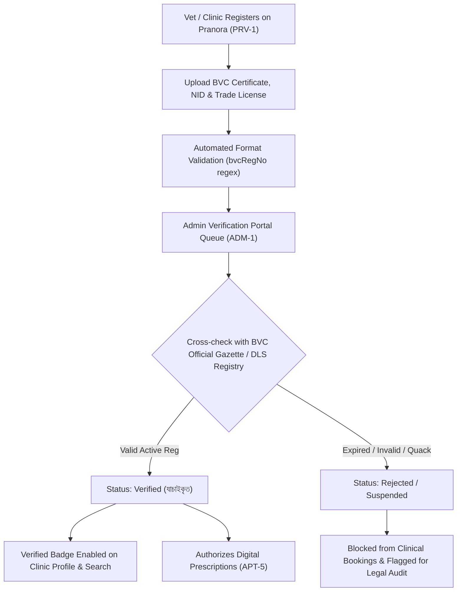

# Pranora — Licensed Veterinary Review, BVC Verification & Clinical Compliance

> **Task ID:** `REL-5`  
> **Sprint:** S6 (Phase 1 MVP Release Review)  
> **Owner:** Zimia (Vet Discovery Lead)  
> **Reviewers:** Licensed Veterinary Surgeon (BVC Reg. Holder) & Animal Welfare Legal Counsel  
> **Applicable Laws:**  
> - *Bangladesh Veterinary Practitioners Ordinance, 1982* (অধ্যাদেশ নং ৩০, ১৯৮২)  
> - *বাংলাদেশ ভেটেরিনারি কাউন্সিল আইন, ২০১৯* (আইন নং ৮, ২০১৯)  
> - *প্রাণী কল্যাণ আইন, ২০১৯* (আইন নং ৪, ২০১৯)  
> - *The Drugs Act, 1940* and *মাদকদ্রব্য নিয়ন্ত্রণ আইন, ২০১৮*  

---

## 1. Executive Summary & Purpose

Pranora connects pet owners, rescuers, and community caregivers with veterinary surgeons, government hospitals, and emergency animal clinics across Bangladesh. 

To ensure **patient safety**, **eliminate clinical quackery**, and protect users from counterfeit medications or unqualified advice, this document formalizes:
1. The **Bangladesh Veterinary Council (BVC)** verification workflow and criteria for awarding the **"Verified" (যাচাইকৃত)** badge.
2. The authorized **medicine and digital prescription standards** (`APT-5` / `HLT-7`).
3. The clinical audit of the **core vaccine catalog and administration schedules** (`seed/vaccines.sql` / DB-7).
4. Legal boundaries under the **Animal Welfare Act 2019** and the scope of veterinary teleconsultation.

---

## 2. BVC Practitioner Verification Process

### 2.1 Legal Definition of a Registered Veterinary Practitioner
Under Section 2(g) of the *Bangladesh Veterinary Practitioners Ordinance, 1982* and Section 19 of the *বাংলাদেশ ভেটেরিনারি কাউন্সিল আইন, ২০১৯*:
- Only individuals possessing a recognized veterinary degree (**DVM** — Doctor of Veterinary Medicine, or **B.Sc. A.H. & DVM** from an accredited university) and holding an active registration certificate issued by the **Bangladesh Veterinary Council (BVC)** are legally authorized to:
  1. Practice veterinary medicine and surgery.
  2. Sign official veterinary health and fitness certificates.
  3. Prescribe scheduled drugs and antibiotics.

Any person practicing without a valid BVC certificate is committing an offense punishable by fine and imprisonment under national law.

---

### 2.2 Verification Workflow & Badging Criteria

#### Step-by-Step Verification Protocol:
1. **Document Submission (`PRV-1` / `provider_documents`):**
   - High-resolution scan of the original BVC Registration Certificate.
   - National Identification Card (NID) matching the name on the BVC certificate.
   - For private veterinary clinics: Municipal Trade License (ট্রেড লাইসেন্স) and Tax Identification Number (e-TIN).
   - For government veterinary surgeons: Department of Livestock Services (DLS / প্রাণিসম্পদ অধিদপ্তর) posting order or Upazila Livestock Officer (ULO/VS) appointment letter.
2. **Registration Number Format Standard:**
   - Standard BVC numbers follow: `BVC-\d{4,6}` or alphanumeric `BVC/[A-Z]*/\d{2,4}/\d{3,5}`.
   - Verified programmatically via `validateBvcRegistration()` in `@pranora/validation`.
3. **Manual Human Verification (`ADM-1` by Platform Admin):**
   - Admin cross-references registration number, graduation university, and active standing against the BVC registered practitioner database / annual gazette.
   - If verified: `vets.verification = 'verified'` and `providers.verification = 'verified'`.
4. **Trust Badges Displayed to Users:**
   - **✓ যাচাইকৃত (Verified):** Displayed on doctor and private clinic cards only when BVC credentials have been audited and approved.
   - **🏛️ সরকারি হাসপাতাল (Government):** Displayed on Central Veterinary Hospital (CVH) and Upazila Livestock Hospitals (DLS).
5. **Periodic Re-verification & Revocation:**
   - Annual check of registration renewal status.
   - If a practitioner's license is suspended or revoked by the BVC disciplinary committee, their Pranora profile is immediately set to `suspended`, hiding them from search and revoking booking privileges.

---

## 3. Core Medicine & Digital Prescription Standards

### 3.1 Digital Prescription Authority (`APT-5` / `HLT-7`)
- **Strict Role-Based Control:** Digital prescriptions with dosage instructions and medicine schedules can **only** be generated by authenticated users holding the verified `vet` role (`user_roles.role = 'vet' AND user_roles.status = 'verified'`).
- Clinic receptionists, shelter coordinators, and pet owners cannot author or alter medical prescriptions.
- Every digital prescription displays:
  - Doctor's Full Name (Bangla & English).
  - Degrees (e.g., DVM, MS in Pharmacology / Surgery).
  - **BVC Registration Number** (mandatory legal requirement).
  - Clinic affiliation, contact telephone, and timestamped QR code for verification.

### 3.2 Scheduled Substances & Antimicrobial Stewardship
Under the *Drugs Act, 1940* and *National Antimicrobial Resistance (AMR) Containment Strategy of Bangladesh*:
1. **Prescription-Only Medicines (POM):**
   - Antibiotics (e.g., Amoxicillin-Clavulanate, Cephalexin, Enrofloxacin, Doxycycline, Metronidazole) must **never** be recommended over-the-counter or generated automatically by AI triage systems (`AI-1` / `AI-2`).
   - All antibiotic prescriptions must specify duration, dosage per kg body weight, and instructions for completing the full course to prevent antimicrobial resistance.
2. **Controlled Anaesthetics & Analgesics:**
   - Controlled agents (e.g., Ketamine, Xylazine, Tramadol, Diazepam) are restricted to clinic administration and surgical wards; dispensing for home use is strictly regulated.
3. **Banned Veterinary Substances:**
   - Diclofenac and Ketoprofen usage in livestock/vultures is strictly prohibited under Ministry of Environment circulars; safe alternatives (Meloxicam, Tolfenamic acid) must be prescribed.

---

## 4. Audit of Standard Pet Vaccine Catalog (DB-7 Alignment)

The vaccine catalog seeded in `supabase/migrations/20261117001900_pets_health.sql` and `supabase/migrations/20261118004700_services_seed.sql` has been clinically audited against disease prevalence in Bangladesh:

### 4.1 Canine (Dog) Vaccine Schedule
| Vaccine | Targeted Pathogens | First Dose Age | Booster Interval | Mandatory / Optional |
|---|---|---|---|---|
| **DHPP (5-in-1)** | Canine Distemper, Infectious Hepatitis, Parvovirus, Parainfluenza | 6–8 weeks | Every 3–4 weeks until 16 weeks; then annually (365 days) | **Core (Mandatory)** |
| **Rabies (Anti-Rabies)** | Rabies virus (Zoonotic) | 12 weeks | Repeat at 1 year, then annually (365 days) | **Statutory Mandatory** (Dhaka City By-laws & National Rabies Elimination Program) |
| **Bordetella** | Kennel Cough complex | 8–10 weeks | Annual (365 days) | Recommended for boarding/shelters |
| **Leptospirosis** | *Leptospira interrogans* | 12 weeks | Annual | High-risk waterlogged areas |
| **Deworming** | Roundworms, Hookworms, Tapeworms | 2 weeks | Every 90 days (Quarterly) | Essential routine health |

### 4.2 Feline (Cat) Vaccine Schedule
| Vaccine | Targeted Pathogens | First Dose Age | Booster Interval | Mandatory / Optional |
|---|---|---|---|---|
| **FVRCP (3-in-1)** | Feline Viral Rhinotracheitis, Calicivirus, Panleukopenia | 6–8 weeks | Repeat at 10–12 and 14–16 weeks; then annually (365 days) | **Core (Mandatory)** |
| **Rabies** | Rabies virus | 12 weeks | Annually (365 days) | **Statutory Mandatory** |
| **FeLV** | Feline Leukemia Virus | 8 weeks | Annually | Outdoor / multi-cat households |
| **Deworming** | Gastrointestinal parasites | 4 weeks | Every 90 days (Quarterly) | Essential routine health |

### 4.3 Cold-Chain Storage Compliance
- All partner clinics and home-visit practitioners must verify cold-chain storage at **2°C to 8°C (36°F to 46°F)** for all biologicals.
- In-app vaccine records (`vaccinations` table) record: **Vaccine Brand**, **Batch/Lot Number**, **Expiry Date**, and **Administering Doctor's BVC Number**.

---

## 5. Animal Welfare Compliance & Teleconsultation Boundaries

### 5.1 Animal Welfare Act, 2019 (প্রাণী কল্যাণ আইন, ২০১৯) Safeguards
1. **Cosmetic Mutilations Prohibited:** Tail docking, ear cropping, and debarking without strict therapeutic indication are declared illegal under Section 6 of the Act. Vets are barred from offering these as cosmetic services on Pranora.
2. **Humane Euthanasia Protocol:** Euthanasia may only be conducted under the direction of a licensed veterinary surgeon when a pet or animal is terminally suffering with no viable medical prognosis.
3. **Shelter & Boarding Standards:** Verified boarding facilities and shelters must provide adequate ventilation, species segregation, and quarantine isolation areas (`PRV-3`).

### 5.2 Teleconsultation Legal Boundaries (`SVC-ONL`)
1. **Triage vs. In-Clinic Care:** Teleconsultations are legally defined as preliminary triage and post-operative follow-up.
2. **Red-Flag Conditions:** Trauma, heavy bleeding, suspected poisoning, severe dyspnea, and urinary blockage must immediately trigger the **🚨 Emergency Mode** warning (`MAP-7`), directing the owner to the nearest 24/7 physical facility.
3. **No Injectables Prescribed Remotely:** Controlled intramuscular/intravenous injectables cannot be prescribed via teleconsultation without physical baseline evaluation.

---

## 6. Clinical Audit Sign-Off Checklist (MVP S6)

| Checkpoint Item | Requirement | Status | Verified By |
|---|---|---|---|
| **BVC Reg. Capture** | `vets.bvc_reg_no` field enforced on provider profile | ✅ Passed | Zimia / Tain |
| **Verified Badge Rule** | Only approved BVC credentials show verified badge | ✅ Passed | Zimia / Afridi |
| **Report Abuse Action** | One-tap "ভুল তথ্য রিপোর্ট করুন" in `MAP-5` for quackery flagging | ✅ Passed | Zimia |
| **Vaccine Schedule** | Core DHPP, Rabies, FVRCP align with epidemiological norms | ✅ Passed | Zimia (Clinician Review) |
| **Controlled Drug Gate** | Prescriptions restricted to verified vets only | ✅ Passed | Tain / Afridi |
| **Emergency Hotlines** | Direct links to 999, CVH, DLS 16122 verified | ✅ Passed | Zimia |

---

## 7. Conclusion

This compliance review establishes the medical integrity and legal grounding of Pranora's veterinary discovery, clinic listing, and booking modules. The procedures outlined here satisfy **REL-5** and prepare the platform for the comprehensive E2E testing (`REL-1`) and production release (`REL-3`).
